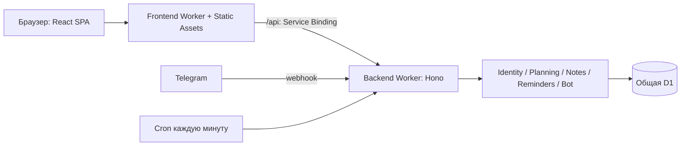

**Архитектурное ревью Planner — 29 сентября 2026**

Проверены backend `d3c1e20` и frontend `49ab9e6b`, включая composition root, публичные контракты, HTTP, application/infrastructure, схему D1, планирование, Telegram, сессию, клиентский кеш и сборку. Учитывались ограничения AGENTS.md: личное использование напоминаний, Cloudflare Free, существующая D1 и один Cron в минуту.

Общая оценка: выбранная архитектура соответствует масштабу проекта. Основной риск находится в согласованности данных между браузером, Telegram и фоновым исполнением. Для дальнейшего развития нужны единые правила записи, обновления кеша и владения данными внутри существующего модульного монолита.

**1. P1 — Защита от потери изменений действует только со стороны Telegram.**

HTTP использует `UpsertGoalEntry` и безусловный upsert, а Telegram — `RecordAnswer` с `expectedRevision` и квитанцией операции. HTTP-контракт не отдаёт ревизию записи. В инспекторе сохранение одной заметки отправляет также значение факта из локального черновика.

Воспроизведён сценарий: сайт прочитал `07:00`; Telegram исправил значение на `07:40`; пользователь изменил заметку в открытом сайте; HTTP сохранил старое `07:00` вместе с заметкой. Актуальное значение потеряно без уведомления. То же решение оставляет без защиты запись из второй вкладки и удаление устаревшего факта.

Источники: [безусловная запись HTTP](/Users/denischernykh/Documents/ChatGPT/planner/backend/src/modules/planning/infrastructure/d1-planning-repository.ts:279), [защита Telegram](/Users/denischernykh/Documents/ChatGPT/planner/backend/src/modules/planning/infrastructure/d1-planning-repository.ts:326), [отправка значения и заметки](/Users/denischernykh/Documents/ChatGPT/planner/frontend/src/widgets/planner-overview/ui/fact-inspector-draft.tsx:72).

Рекомендация: общий application-сценарий записи с проверкой ревизии для обоих каналов; ревизия в публичном контракте, явный ответ о конфликте и его обработка в UI. HTTP PUT может сохранять семантику полной замены, но должен проверять версию, на основе которой пользователь редактировал данные. Аналогичная проверка нужна для удаления.

**2. P2 — План в открытой вкладке не узнаёт об изменениях из Telegram.**

Глобально отключён `refetchOnWindowFocus`; запрос плана не переопределяет настройку и не имеет периодического обновления. Изменения узнаются при повторном монтировании, восстановлении соединения или локальной invalidation. При обычном переключении сайт → Telegram → сайт таблица остаётся старой. Поле `today` также остаётся из последнего ответа, поэтому после полуночи новый день может оставаться недоступным для ввода до обновления запроса.

Источники: [настройки QueryClient](/Users/denischernykh/Documents/ChatGPT/planner/frontend/src/app/config/query-client.ts:3), [запрос плана](/Users/denischernykh/Documents/ChatGPT/planner/frontend/src/widgets/planner-overview/ui/plan-overview.tsx:9), [использование today](/Users/denischernykh/Documents/ChatGPT/planner/frontend/src/widgets/planner-overview/ui/plan-overview-content.tsx:23).

Рекомендация: централизовать политику обновления плана, обновлять его при возврате во вкладку и при смене локального дня. Для одновременно открытых сайта и Telegram можно добавить редкий polling только активного плана. Это дополняет защиту ревизиями из пункта 1: refetch сам по себе не устраняет гонки.

**3. P2 — Отозванная сессия может оставаться авторизованной в клиентской модели.**

`useCurrentSession()` сначала проверяет `query.data`, затем ошибку. После успешного запроса React Query сохраняет предыдущие данные при неудачном refetch. В отдельном тесте повторный `/api/auth/me` вернул `401 UNAUTHENTICATED`, query перешёл в `error`, но хук продолжил возвращать `authenticated`.

Вторая часть той же проблемы: `clearCurrentSession()` удаляет только запрос `/api/auth/me`, оставляя планы и настройки в кеше. Ключи персональных запросов не содержат идентификатор пользователя. Полный browser redirect при OIDC обычно пересоздаёт приложение, поэтому отдельную утечку данных между аккаунтами этим ревью не доказали. Доказан неверный переход состояния при `401`; backend продолжает проверять доступ независимо от UI.

Источники: [приоритет данных над ошибкой](/Users/denischernykh/Documents/ChatGPT/planner/frontend/src/entities/session/api/session.ts:18), [очистка кеша](/Users/denischernykh/Documents/ChatGPT/planner/frontend/src/entities/session/model/session-cache.ts:5), [logout](/Users/denischernykh/Documents/ChatGPT/planner/frontend/src/features/authentication/model/use-logout.ts:16).

Рекомендация: известные ответы об утрате авторизации должны иметь приоритет над кешированной личностью. Согласовать обработку `401` всех персональных запросов и мутаций; при logout или смене пользователя отменять запросы и очищать персональный кеш либо создавать новый QueryClient. Сетевую ошибку обрабатывать отдельно от подтверждённого отзыва сессии.

**4. P2 — Ежеминутная очистка истории расходует чтения пропорционально всей накопленной истории.**

`tick()` каждый раз вызывает `recover()`, где две очистки ищут `created_at < cutoff LIMIT 25`. Индексов по `created_at` нет ни у `reminder_jobs`, ни у `planning_entry_commands`. `EXPLAIN QUERY PLAN` в тестовом D1 подтвердил `SCAN reminder_jobs` и `SCAN planning_entry_commands`. При отсутствии просроченных строк ограничение 25 не сокращает чтение таблицы.

Для иллюстрации: 3 600 сохранённых строк суммарно в двух таблицах × 1 440 запусков = около 5,184 млн просмотренных строк в сутки только на поиск просроченной истории. Это оценка по плану запросов, а не замер production. D1 Free допускает 5 млн прочитанных строк в день и после исчерпания лимита отклоняет запросы до сброса квоты. Правила подсчёта сканирований и лимит подтверждены [документацией D1](https://developers.cloudflare.com/d1/platform/pricing/).

Источники: [очистка](/Users/denischernykh/Documents/ChatGPT/planner/backend/src/modules/reminders/infrastructure/d1-reminder-repository.ts:317), [вызов каждый tick](/Users/denischernykh/Documents/ChatGPT/planner/backend/src/modules/reminders/application/service.ts:163), [схема](/Users/denischernykh/Documents/ChatGPT/planner/backend/src/platform/database/schema.ts:109).

Рекомендация: добавить индексы срока хранения новой миграцией; выполнять retention реже внутри уже существующего Cron, сохранив ограниченные партии удаления. Проверять `rows_read` и план запроса на накопленной истории. Изменение расписания retention должно учитывать, что пропущенный запуск допустим, а доставка продолжает работать каждую минуту.

**5. P2 — Сохранение общих настроек и расписания цели допускает несогласованное nextRunAt.**

Общий сценарий сначала читает все правила и вычисляет новые даты вне транзакции. Затем репозиторий обновляет только `nextRunAt` по `goalId`, без проверки версии прочитанного правила. В промежутке другой запрос может изменить время цели.

В отдельном D1-тесте общий запрос прочитал `09:00` и начал смену timezone на UTC; параллельный запрос записал цели время `11:00`; общий запрос завершился и записал рассчитанное для `09:00` значение `nextRunAt`. В базе одновременно оказались правило `11:00` и запуск на `09:00 UTC`. Атомарность финального batch не защищает чтение, выполненное до него.

Источники: [чтение и расчёт](/Users/denischernykh/Documents/ChatGPT/planner/backend/src/modules/reminders/application/service.ts:49), [запись без проверки версии](/Users/denischernykh/Documents/ChatGPT/planner/backend/src/modules/reminders/infrastructure/d1-reminder-repository.ts:64).

Рекомендация: ввести версию конфигурации расписания и проверять её при записи производных дат; при конфликте повторять расчёт либо явно отклонять сохранение. Одинаковая политика нужна для изменения общего timezone, конкретного правила и продвижения расписания из Cron. Уже существующие условные обновления в `advanceGoal` показывают подходящее направление.

**6. P2 — Два Git-репозитория имеют незафиксированную зависимость сборки друг от друга.**

`frontend pnpm check` вызывает `api:update`, который напрямую импортирует `../../../backend/src/app/create-app.ts`. Для прохождения gate нужны соседняя папка с точным именем, зависимости backend и совместимый текущий checkout. Коммит frontend и его lockfile не фиксируют версию этого backend. Сам `pnpm build` использует сохранённый клиент и может работать отдельно; проблема именно в воспроизводимости полного gate и синхронизации контракта.

В backend есть check-only GitHub Actions. В frontend `.github/workflows` отсутствует. Локальное совпадение OpenAPI поэтому не обеспечивает проверку совместимости двух репозиториев при независимых изменениях.

Источники: [импорт исходников соседнего repo](/Users/denischernykh/Documents/ChatGPT/planner/frontend/scripts/openapi/sync-openapi.ts:80), [обновление артефактов во время проверки](/Users/denischernykh/Documents/ChatGPT/planner/frontend/scripts/openapi/check-openapi.ts:42), [backend CI](/Users/denischernykh/Documents/ChatGPT/planner/backend/.github/workflows/check.yml:1).

Рекомендация: разделить экспорт backend-контракта, детерминированную генерацию клиента из сохранённого snapshot и интеграционную проверку совместимости. Для двух repo фиксировать backend SHA/версию OpenAPI в manifest и получать этот артефакт в check-only CI. Альтернатива при общем цикле изменений — workspace/monorepo; решение стоит принять явно, поскольку оба варианта работоспособны.

**7. P2 — Проверка импортов не обеспечивает фактическую автономность модулей backend.**

Есть два конкретных обхода границ. Application-код reminders импортирует исполняемый `PlanningError` через корень planning, который одновременно импортирует HTTP и D1 wiring. Кроме того, `D1ReminderRepository.recover()` напрямую удаляет строки таблицы `planning_entry_commands`, принадлежащей Planning. Проверка путей считает root-import допустимым и не видит зависимость через строку SQL.

Источники: [application → module root](/Users/denischernykh/Documents/ChatGPT/planner/backend/src/modules/reminders/application/service.ts:2), [корень с инфраструктурой](/Users/denischernykh/Documents/ChatGPT/planner/backend/src/modules/planning/index.ts:1), [доступ к чужой таблице](/Users/denischernykh/Documents/ChatGPT/planner/backend/src/modules/reminders/infrastructure/d1-reminder-repository.ts:330), [проверка границ](/Users/denischernykh/Documents/ChatGPT/planner/backend/scripts/check-module-boundaries.mjs:51).

Последствие: application reminders получает транзитивную зависимость от транспорта и базы; изменение внутренней таблицы Planning требует знания SQL в Reminders, несмотря на формально публичные межмодульные контракты. Это риск сопровождения, а не доказанная текущая ошибка выполнения.

Рекомендация: публичные application-контракты и ошибки экспортировать через файл без инфраструктурных зависимостей; runtime-фабрики оставить в `index.ts`. Retention команд Planning должен принадлежать Planning и вызываться из composition root через публичную операцию. Дополнить gate правилами для application → wiring и явной картой владельцев таблиц. Общая механическая Drizzle schema сама по себе соответствует разрешённому исключению из AGENTS.md.

**8. P3 — Весь frontend поставляется одним начальным JS-бандлом.**

Все страницы импортируются статически в router. Сборка создала один JS-файл 885,84 kB, gzip 275,14 kB и предупреждение Vite о размере. Экран входа получает также код таблицы, drag-and-drop, форм и напоминаний. Размер подтверждён сборкой; скорость на реальном устройстве и Core Web Vitals не измерялись.

Источник: [статические импорты маршрутов](/Users/denischernykh/Documents/ChatGPT/planner/frontend/src/app/router/router.tsx:4).

Рекомендация: разделить загрузку по маршрутам и отложить тяжёлые интерфейсы. Планировщик целесообразно предзагружать после подтверждения сессии. Оптимизацию оценивать по размеру начальной загрузки и времени открытия на целевом устройстве.

**Что в текущей архитектуре стоит сохранить.**

Связка frontend Worker → Service Binding → Hono поддерживает один browser origin и согласована с cookie-сессией. В backend есть application-порты, конкретные D1-адаптеры и явный composition root. Owner-scoped доступ, Problem Details и OpenAPI задают общие правила транспорта. Telegram уже использует устойчивые event keys, атомарное получение задания, квитанции команд и отдельное состояние неопределённой доставки. Для текущего масштаба это разумная основа. Механическую общую схему D1 и небольшой объём слоёв можно сохранить.

Во frontend полезны генерация API-клиента, проверка слоёв и использование серверного `today`. Следующий практический шаг — небольшой общий слой операций с планом, в котором сосредоточены query options, ревизии, invalidation и обработка конфликтов; сейчас эти правила распределены между UI-компонентами. Дробить каждый компонент на отдельную feature только ради симметрии не требуется.

**Рекомендуемый порядок работы.**

1. Единая запись фактов с ревизией и UI конфликтов — пункт 1; одновременно согласовать обновление плана из пункта 2.
2. Исправить переходы сессии и очистку персонального кеша — пункт 3.
3. Добавить retention-индексы и согласованное версионирование расписаний — пункты 4–5.
4. Зафиксировать межрепозиторный контракт и усилить границы модулей — пункты 6–7.
5. Разделить начальную загрузку UI — пункт 8.

**Проверки и границы выводов.**

Оба полных `pnpm check` завершились с кодом 0: backend — 101 тест в 7 файлах, frontend — 75 тестов в 25 файлах. Прошли typecheck, архитектурные gate, frontend OpenAPI sync, сборка и Worker dry-run. В frontend остались два предупреждения Biome, два предупреждения Steiger `insignificant-slice` и предупреждение о размере бандла. Предупреждения о размере feature сами по себе дефектами не считаю.

Дополнительно выполнены четыре временных воспроизведения: потеря значения при stale HTTP-записи, два SQL full scan в одном тесте, гонка общих/частных настроек, неверное состояние сессии после `401`. Все подтвердили описанное поведение. Это тесты, утверждающие наличие дефекта, а не тесты исправления.

Исходники воспроизведений сохранены отдельно от репозиториев: [backend](architecture-review-evidence/backend.spec.ts), [frontend](architecture-review-evidence/frontend.test.tsx); результаты: [backend](architecture-review-evidence/backend-repro.log), [frontend](architecture-review-evidence/frontend-repro.log). Для повторения backend-файл временно помещается в `backend/test/architecture-review.spec.ts` и запускается `pnpm exec vitest run test/architecture-review.spec.ts`; frontend-файл — в `frontend/src/test/architecture-review.test.tsx`, запуск `pnpm exec vitest run src/test/architecture-review.test.tsx` из соответствующего repo.

Временные тесты удалены из обоих repo после выполнения; production-код и конфигурация не изменены. Проверки были локальными, с тестовой D1. Реальная доставка Telegram, production-метрики, remote migrations и deploy в это ревью не входили. Workers-практики сверялись с [официальным руководством Cloudflare](https://developers.cloudflare.com/workers/best-practices/workers-best-practices/); runtime-типы backend проверены штатным `wrangler types --check`.
