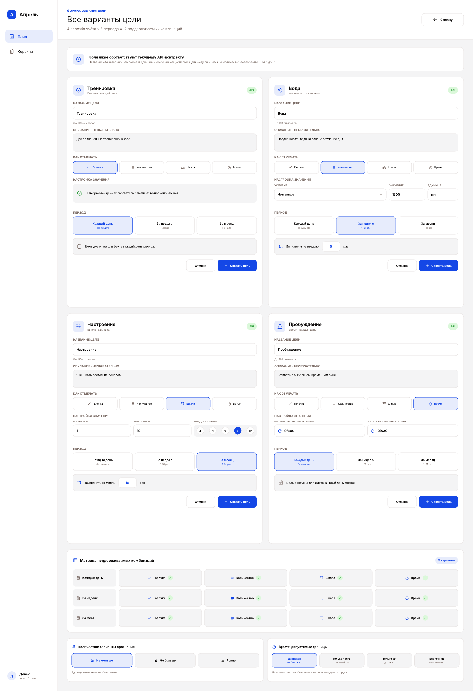

# UI design references

These PNG exports are the visual reference for AI agents and developers. Open
the images before changing the Planner plan screen or the goal-creation flow.
The editable source lives in Pen; the exports are committed so repository-based
agents can inspect the current layout without local Pen access.

## September plan

The screen contains a weekly/monthly plan grid and a right-side fact inspector.
Controls in the grid represent checkbox, count, scale, and time tracking.

## Goal-creation variants

This screen documents the supported combinations of tracking type and period.
Use the API contract and `src/app/styles/index.css` as the semantic source for
fields and visual tokens.
