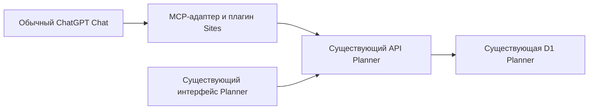

# Архив: проверка прототипа через ChatGPT Sites

Текущая реализация — личный плагин **Ритм** с общим React UI: [описание](../chatgpt/README.md).
Этот документ сохраняет результаты первоначального эксперимента, а не инструкцию новой версии.

Дата проверки: **2026-10-01**. Статус: **личный сценарий выполнен в обычном Chat web**.
[Planner MCP Test](https://planner-mcp-test.scary-rustles-7p.chatgpt.site) опубликован
с доступом только владельцу; плагин установлен и подключён через обычный Chrome.
По запросу владельца создана ежедневная цель на один отклик и записан один
отклик за 1 октября. Повторное чтение плагином и независимая проверка API Planner
подтвердили результат и отсутствие дубликата.

**Текущий объём — простой сценарий с готовыми значениями.** Читаем план,
записываем результат дня и создаём нужную новую цель. `200 мл` означает
сохранить ровно `200`; прибавление «ещё 200 мл» в этот тест не входит.
Инструкция запуска и первый прогон: [chatgpt/README.md](../chatgpt/README.md).

## Что хотим проверить

Пользователь Planner подключает интеграцию к обычному **ChatGPT Chat** и пишет,
например: «Выпил 200 мл воды, проснулся в 10:30, прочитал 10 страниц. Также
добавь новую цель — откликаться на 1 вакансию». ChatGPT понимает запрос,
вызывает инструменты приложения и сохраняет изменения в аккаунте пользователя.

**Первый эксперимент — управление настоящими целями владельца в готовом
Planner через обычный ChatGPT Chat.** В Sites размещаем только MCP-адаптер
и связанный плагин. Адаптер вызывает существующий API Planner. Результат
проверяем в существующем интерфейсе Planner.

Код frontend и backend Planner, его конфигурацию, D1 и Cron для этого
эксперимента не меняем. Записи, явно запрошенные владельцем через ChatGPT,
сохраняются штатным API в его настоящем аккаунте. Отдельного трекера,
базы целей на Sites или вымышленных целей для демонстрации не создаём.



Возможность распространить этот плагин другим личным аккаунтам — отдельная
следующая проверка. Работа с целями владельца и распространение плагина
оцениваются отдельно. Текущий личный тест не подменяем проверкой `ping`/`echo`.

## Анонс и вложенные посты

Это цепочка цитат, а не один самостоятельный анонс:

1. **Тибо / Thibault Sottiaux, @thsottiaux**, 2026-10-01, 04:44 UTC:
   [пост, который прислал пользователь](https://x.com/thsottiaux/status/2105519215092584786?s=20).
   Он сообщает о создании и размещении MCP-серверов прямо через ChatGPT и пишет:

   > And restrict its access to anyone you want or share it with the world.

2. Этот пост **цитирует Max Stoiber, @mxstbr**, 2026-09-30, 22:43 UTC:
   [вложенный анонс Sites](https://x.com/mxstbr/status/2105428405571428785).
   Max сообщает о хостинге MCP-серверов с plugin extensions в Sites.
   Пример запроса — создать через `@sites` список дел для использования в ChatGPT.
   Описана последовательность: создать MCP-сервер, разместить его в Sites,
   превратить в плагин и установить автору для web, mobile и desktop.
   Полный список действий также виден на скриншоте из обсуждения.

3. Max, в свою очередь, **цитирует вопрос @DishwasherTag**, 2026-09-30,
   21:29 UTC:
   [исходный вопрос о хостинге backend](https://x.com/DishwasherTag/status/2105409741564366949).
   Автор спрашивает, сможет ли инфраструктура OpenAI, например Sites,
   обслуживать backend для Plugin Extensions.

Контекст Max связывает анонс Тибо с плагинами для ChatGPT. Однако установка
плагина **автору** и его распространение **другим личным аккаунтам** остаются
разными проверками. Анонс не объясняет все условия второго шага.

## Что говорит документация

[Hosting a plugin with ChatGPT Sites](https://help.openai.com/en/articles/20001547-hosting-a-plugin-with-chatgpt-sites)
описывает размещение MCP в Site, первоначальную публикацию владельцем,
создание связанного плагина, установку и подключение собственного аккаунта.
В этом сценарии ручное подключение через Developer Mode не указано.

Та же статья ограничивает распространение: Business и Enterprise могут
делиться плагином внутри своего workspace; личные аккаунты сейчас не могут
передавать Site-hosted плагин другим пользователям через приглашения или
ссылку. Доступ к самому Site не предоставляет его плагин. Статья также
предупреждает о постепенном запуске новых возможностей.

Здесь есть видимое расхождение с широким обещанием анонса. Возможное объяснение
— разные ограничения для доступа к MCP-серверу и установки плагина. Задержка
документации или различия в rollout также возможны. **Ни одно объяснение
пока не подтверждено практическим тестом.**

## Где хранить исходники

Sites поддерживает локальный исходный проект. Файл `.openai/hosting.json`
связывает его с размещённым Site, а сохранённая версия привязана к Git-коммиту.
Создать Site на web можно и без локального проекта. Для нашего эксперимента
выбираем локальную разработку и Git, чтобы сохранять и проверять изменения.
См. [Sites: проекты, версии и публикации](https://learn.chatgpt.com/docs/sites#understand-projects-versions-and-deployments).

**Предлагаемое место — `sites-mcp-test/` в текущем репозитории Planner**, рядом
с `backend/` и `frontend/`. Это самостоятельный исходный пакет MCP-адаптера.
Новый Git-репозиторий внутри Planner не нужен.

Созданная структура исходного пакета:

```text
planner/
├── backend/                 # существующий Hono API и Worker app
├── frontend/                # существующий интерфейс Planner
├── sites-mcp-test/          # MCP-адаптер и простой экран для ChatGPT
│   ├── .openai/hosting.json # project_id и capabilities: ["mcp"]
│   ├── package.json
│   ├── src/                # три команды, точка входа UI, HTTP-клиент и Worker
│   ├── scripts/            # локальный запуск и сборка
│   └── tests/              # проверка Worker-артефакта
├── docs/sites-mcp-test.md
├── package.json
├── pnpm-workspace.yaml
└── pnpm-lock.yaml
```

Пакет добавлен в существующий pnpm workspace. Используем
Node 24, pnpm 11.15.1 и один корневой lockfile. Внутри пакета второго lockfile
или вложенного `.git` не создаём. Файл привязки Site относится к тестовому
пакету; корень Planner не объявляем приложением для Sites.

У Sites есть собственный удалённый репозиторий исходников для публикации:
инструменты Sites выдают его адрес и временное право записи, а сохранение
версии требует SHA отправленного туда коммита. Это служебная копия для
хостинга; канонический код продолжаем вести в репозитории Planner.
Основание — доступные контракты инструментов Sites
`create_source_repository_write_credential` и `save_site_version`,
проверенные 2026-10-01. В выполненном эксперименте исходники отправлены в
этот служебный репозиторий, точный SHA подтверждён чтением remote HEAD.

**Публикация подпакета проверена через служебный экспорт.** Экспорт содержит
исходники адаптера, исходный общий lockfile, настройки workspace и обёртку
сборки с результатом в корневом `dist/server/index.js`. Файл привязки размещён
в корневом `.openai/hosting.json` экспорта и содержит тот же ID Site.
Штатный workflow Sites проверяет, собирает и отправляет эту копию, затем
упаковывает архив с `dist/.openai/hosting.json` и Worker entrypoint.

Если штатный workflow требует отдельный корень исходного проекта, готовим
экспорт тестового пакета в служебный репозиторий Sites. В экспорт входят
исходники теста, manifest и необходимые файлы сборки из workspace. Его
воспроизводимость проверяем до первой публикации. В качестве способа можно
использовать отдельное экспортируемое Git-дерево; конкретный скрипт выбираем
после проверки требований starter и публикации. Точность экспортируемого
дерева важнее выбора Git-команды.

## Как разделить деплой

| Что публикуем | Источники | Назначение | Порядок |
| --- | --- | --- | --- |
| Planner | существующие `backend/` и `frontend/` | действующий Cloudflare Worker `app` | для этого эксперимента ничего не публикуем |
| MCP-адаптер | `sites-mcp-test/` и нужные файлы сборки | отдельный проект Sites | локальная проверка, отправка исходников в служебный remote Sites, сохранение версии, публикация этой версии |

Корневая команда `pnpm deploy` продолжает публиковать только Planner.
Публикация теста — отдельный явно запущенный процесс. CI остаётся check-only.
Автоматическую публикацию Sites при push для эксперимента не включаем.

Сборку Sites выполняем из того же дерева, которое отправили в его remote.
В записи версии указываем SHA **этого дерева**, а не SHA коммита Planner,
если экспорт создал другой коммит. В журнале сохраняем соответствие двух SHA.
Архив сборки должен соответствовать отправленным исходникам.

После этого Sites сохраняет версию, а затем публикует выбранную сохранённую
версию. Полученный URL является production URL, включая приватную публикацию.
Первую публикацию MCP Site выполняет владелец для создания связанного плагина.
См. [версии Sites](https://learn.chatgpt.com/docs/sites#understand-projects-versions-and-deployments)
и [создание плагина](https://help.openai.com/en/articles/20001547-hosting-a-plugin-with-chatgpt-sites).

Независимость деплоев обеспечивается выбором проекта и артефакта, а не
наличием двух Git-репозиториев. В существующем аккаунте Cloudflare сохраняем
один Worker `app`, его D1 и Cron. Цели и записи остаются в D1 Planner.
Адаптер в Sites обращается к Planner по HTTPS и не получает прямой доступ к D1.

## Минимальный прототип

Название: **Planner MCP Test**. Создан MCP-сервер с описаниями
инструментов, схемами аргументов и HTTP-клиентом существующего API Planner.
Используем stateless Streamable HTTP из TypeScript SDK и Web API Worker.
Сборка создаёт `dist/server/index.js` и `dist/.openai/hosting.json` по форме
доступного Worker-шаблона Sites; на странице — название и версия интеграции.
Совместимость сборки с локальным Worker проверяется отдельно от размещения в Sites.
Список целей, формы трекера и новое хранилище на Sites не нужны.

Три инструмента для управления настоящим аккаунтом:

| Инструмент | Существующий API | Действие |
| --- | --- | --- |
| `get_plan` | `GET /api/plans/{month}` | читает собственные цели, их типы и записи; возвращает дату `today` из Planner |
| `create_goal` | `POST /api/plans/{month}/goals` | создаёт настоящую цель с названием, tracking и cadence |
| `record_entry` | `PUT /api/goals/{goalId}/entries/{date}` | сохраняет отметку выполнения, число или время за выбранный день |

ChatGPT разбирает свободный текст и выбирает вызовы этих инструментов.
MCP-адаптер преобразует аргументы в HTTP-запрос и возвращает ответ Planner.
Проверка владельца цели, правила tracking, вычисление `met` и сохранение
остаются в существующем backend. Отдельный вызов OpenAI API внутри адаптера
для этого сценария не планируется.

«Отметить выполненной» означает запись результата дня, а не удаление цели.
Для цели типа `check` это `{ completed: true }`; для количества и времени
передаётся соответствующее значение. Название разрешается в ID по прочитанному
плану. При неоднозначном названии или неясной периодичности новой цели
ChatGPT запрашивает уточнение.

**Семантика теста:** `PUT` заменяет значение дня. Пользователь задаёт итог
целиком: «запиши итоговое значение 200 мл». Адаптер отправляет `{ value: 200 }`
без чтения старого значения для прибавления. Повторный `PUT` с тем же значением
оставляет результат `200`. Время передаём сразу в формате `10:30`.
При неоднозначном таймауте сначала перечитываем план; автоматического повтора
создания цели нет. Расширение сценария до прибавления остаётся за пределами
этого прототипа.

Чтение объявляем read-only, создание и запись — действиями записи;
штатные подтверждения ChatGPT учитываем в тесте.

Контракты проверены по текущему коду:
[HTTP API целей](../backend/src/modules/planning/presentation/http.ts),
[сохранение записи](../backend/src/modules/planning/application/entries/upsert-goal-entry.use-case.ts).

## Подключение собственного аккаунта без изменений Planner

Существующий API использует `__Host-session`, а запросы записи проверяют
`Origin`. Отдельный API token или OAuth для MCP в просмотренном коде не найден.
Вход в плагин Sites сам по себе не авторизует запросы к Planner.

Для **закрытого личного эксперимента** планируем использовать действующую
сессию владельца Planner как серверный secret MCP-адаптера:

1. Владелец входит в Planner обычным способом. Значение сессии задаётся через
   защищённую настройку secret в Sites, без отправки в чат, Git или журнал.
   В документах и примерах фигурирует только имя `PLANNER_SESSION`.
2. HTTP-клиент адаптера передаёт эту сессию в cookie `__Host-session` только
   на фиксированный origin Planner. Для записи передаёт предусмотренный
   существующим API `Origin` Planner; браузерные `Sec-Fetch-*` не пересылает.
   URL, cookie и origin не принимаются из аргументов, сформированных моделью.
3. До работы с целями адаптер вызывает `GET /api/auth/me`. Полученный аккаунт
   должен совпасть с аккаунтом владельца, а чтение плана — с данными его
   обычного интерфейса. Только после этого проверяем запрошенные владельцем записи.
4. При `401` адаптер сообщает о необходимости обновить подключение.
   Авторизацию Planner не отключаем и проверку origin не меняем.

В прототипе дополнительно задаём `PLANNER_OWNER_EMAIL` — email владельца
ChatGPT. При каждом вызове инструмента сравниваем его с identity
`oai-authenticated-user-email`, полученной от Sites. Без совпадения вызов
Planner запрещён. Передача этой identity на опубликованный MCP endpoint
подтверждена успешными чтением, созданием цели и записью через плагин в Chat.
Локальный `dev` имитирует identity только на loopback.

Подключение выполнено: сессия перенесена из авторизованного браузера напрямую
в защищённую настройку Site, значение скрыто. Сессия истекает или может быть
отозвана. Это временный
способ для одного владельца, а не готовая схема авторизации всех пользователей.
Она предоставляет доступ к его аккаунту, поэтому Site и MCP остаются доступны
только владельцу. Плагин с такой конфигурацией другим людям не передаём.

Основание:
[аутентификация сессией](../backend/src/modules/identity-access/presentation/http.ts),
[проверка origin](../backend/src/platform/http/request-pipeline.ts).

## Порядок эксперимента

### 1. Подготовить локальный проект

Пакет MCP-адаптера, три инструмента и HTTP-клиент к готовому Planner созданы.
Локальный workflow описан в [README](../chatgpt/README.md).
Обработку аргументов и ответы API проверить локально на fixtures; это проверки
кода адаптера, а не замена последующего теста на настоящем аккаунте.
Подготовить воспроизводимую сборку и экспорт, если он нужен. Пройти
корневой `pnpm check`; при изменении импортов — `pnpm boundaries:check`.

### 2. Опубликовать приватный тест для владельца

Использовать личный ChatGPT владельца. Зафиксировать тариф, доступность Sites и плагинов.
Создать один тестовый Site, сохранить его настоящий `project_id` и повторно
использовать этот проект при обновлениях. Опубликовать проверенную версию
для владельца. Проверить появление связанного плагина, его установку и
подключение через штатный интерфейс. Настроить доступ к собственному аккаунту
Planner по разделу выше. Публичную публикацию и передачу другим аккаунтам
в личный эксперимент не включаем.

У Sites нет отдельного интерфейса управления в Codex CLI; для управления
проектом используем ChatGPT web или desktop. CLI подходит для локального
редактирования и проверки исходников.
См. [Sites](https://learn.chatgpt.com/docs/sites).

### 3. Прочитать свои настоящие цели в обычном Chat

Developer Mode выключен. Открыть новый обычный Chat, выбрать или упомянуть
плагин через доступный интерфейс и отправить:

> Покажи мои цели на сегодня и текущий прогресс.

Проверить фактический вызов `get_plan` и совпадение данных с обычным интерфейсом
Planner: названия, типы целей, значения и дата. Успешный ответ `/health`
или простое повторение текста моделью не заменяют эту проверку.

### 4. Изменить собственную цель и создать нужную новую

Выбрать реально существующую цель и отправить соответствующий запрос.
Примеры, используемые только если у владельца уже есть такие цели:

> Прочитал 10 страниц сегодня. Запиши это в мою цель чтения.

В простом тесте уточняем итог: «Запиши итоговое значение 10 страниц за
сегодня». Оно заменяет прежнее значение дня; сумму не вычисляем.

> Отметь мою цель «…» выполненной за сегодня.

Затем проверить создание настоящей цели, которую владелец хочет добавить:

> Добавь ежедневную цель — откликаться на 1 вакансию.

Сверить вызовы `record_entry`/`create_goal`, ответы API и данные в **существующем
интерфейсе Planner**. В новом чате перечитать план: записи должны сохраняться.
Ответ «готово» без изменения в Planner не засчитываем.

### 5. Проверить исходный запрос с несколькими действиями

Когда отдельные операции работают, проверить один запрос с водой,
пробуждением, чтением и созданием новой цели. До записи прочитать исходные
значения. Сопоставить существующие цели; в первом тесте время задаём сразу
как `10:30`, количество — в единицах самой цели, дату — по `today` Planner. Для отсутствующей
или неоднозначной цели ChatGPT должен уточнить действие.

Нужную новую цель не создавать второй раз, если она уже добавлена предыдущим
шагом. Для составного запроса сверить результат каждой операции отдельно:
текущий API не обещает общую транзакцию для всех вызовов. При частичном успехе
ChatGPT сообщает, какие изменения сохранены и какие требуют исправления.

### 6. Проверить дополнительные поверхности и обновление

После успешного чтения и записи в обычном Chat web повторить сценарий
в Chat desktop и mobile на том же аккаунте. Обещание работы на всех трёх
поверхностях подтверждаем отдельно. Успех в Work или Codex не заменяет Chat.

Изменить описание одного инструмента или диагностическое поле ответа,
опубликовать новую версию того же MCP Site. Проверить обновление инструментов
и необходимость переподключения. Planner для обновления адаптера не публикуем.

## Критерии результата

| Наблюдение | Что можно заключить |
| --- | --- |
| В обычном Chat показаны настоящие цели владельца, запись и создание подтверждены в Planner, Developer Mode выключен | основной личный сценарий подтверждён |
| Плагин установлен, но Planner возвращает `401` | установка проверена; подключение аккаунта и управление целями ещё не работают |
| Работает только чтение | управление целями через запись пока не подтверждено |
| Работает только `ping`/`echo` или отдельная демонстрационная база | нужный эксперимент не выполнен |
| MCP подключён вручную через Developer Mode | подтверждён ручной путь, а не установка через Sites без Developer Mode |
| Работает только в Work или Codex | обычный Chat пока не проверен |
| Функция отсутствует или показан запрет для аккаунта | фиксируем конкретное ограничение; причину rollout считаем установленной только при наличии подтверждения |

Ревью публичного каталога и автоматические проверки Sites — отдельные вещи.
Успех теста без заявки в каталог не означает отсутствие проверок платформы.
Он также не гарантирует доступность на любых тарифах, аккаунтах и в регионах.

## Что записать после теста

| Поле | Значение |
| --- | --- |
| Дата и время, часовой пояс | 2026-10-01, публикация MCP в 08:54 UTC, инструкции в 09:09 UTC, UI в 09:42 UTC; `today` Planner — 2026-10-01 |
| Тариф владельца, личный или корпоративный workspace | личный аккаунт Pro |
| Поверхность, режим Chat, модель, Developer Mode | обычный Chat web в Google Chrome; Pro (`gpt-6-pro`); ручное подключение через Developer Mode не использовалось, положение переключателя отдельно не проверяли |
| Коммит Planner → коммит экспорта Sites | база Planner `876759aba94ca145770e93a25b522d77abe8375d` плюс локальные изменения MCP → проверенный в Chat экспорт `35a31aa3fb935547a9e6af799aeb8ee12ab7e102`; текущий экспорт `26adf14b428dc0f45772e580568dfbd0fc76609d` добавляет UI; исходники адаптера в основном репозитории пока не закоммичены |
| Локальные проверки MCP | 11 тестов пройдены: MCP-клиент, UI discovery, авторизация точки входа и собранный Worker в локальном workerd; браузерный тест UI на fixtures пройден |
| Site URL, `project_id`, ID версии и deployment | `https://planner-mcp-test.scary-rustles-7p.chatgpt.site`; `appgprj_6abe160dd4d08191ab9bfaacd10334f8`; текущая версия `appgprj_6abe160dd4d08191ab9bfaacd10334f8~appgver_b5aeb9caa47c8191892f156906c25dea`; deployment `appgdep_6abe2b19acf481919692995b941400ba`, `succeeded`, `has_mcp: true`, конфигурация revision 3 |
| ID плагина и фактически выданный MCP endpoint | `plugin_asdk_app_sites_ba1679cfc5588191b7b2c15db7428c94`; `https://planner-mcp-test.scary-rustles-7p.chatgpt.site/mcp` |
| Сопоставление подключения с собственным аккаунтом Planner | успешное чтение одного аккаунта локальным адаптером до публикации и через Site после подключения; независимое чтение API Planner совпало с результатом Chat |
| Установка, подключение, подтверждения записей | установлено и подключено через Plugins → Личные → Созданные вами; в настройках видна основная подключённая учётная запись; пользователь явно выбрал цель и результат; режим прав плагина не меняли |
| Исходное состояние и результаты реальных операций в Planner | октябрьский план был пуст; создана одна цель; результат за `today` — `value: 1`, `met: true`; повторное чтение подтвердило ровно одну совпадающую цель |
| Chat web / desktop / mobile | Chat web: выполнено; desktop и mobile не проверялись |
| Обновление плагина после повторной публикации | опубликован тот же Site; ID подключённого плагина сохранился; «Обновить инструменты» в управлении плагином обнаружило `open_planner` и UI; повторное подключение аккаунта не потребовалось |
| Точные ошибки, скриншоты и окончательный вывод | первый архив с корневым `server/index.js` отклонён; первое размещение без capability не объявило MCP; исправлены упаковка и `capabilities: ["mcp"]`; реальный сценарий выполнен через созданный Sites плагин |

В журнал сохраняем идентификаторы и наблюдения, но не токены, cookie,
credentials, `.dev.vars` или содержимое личных аккаунтов.

В [чате проверки](https://chatgpt.com/c/6abe2127-87f4-83eb-9092-f71391af6ee9)
зафиксирована последовательность `get_plan` → `create_goal` → `record_entry` →
`get_plan`. Метаданные вызовов содержат resource URI созданного Sites плагина.
Дополнительно авторизованный браузер Planner прочитал штатный API: один
совпадающий объект цели, один отклик за 1 октября, дневное условие выполнено.
[Новый обычный Chat](https://chatgpt.com/c/6abe2232-432c-83ed-a4ea-c914f60a5812)
заново вызвал `get_plan` и получил ту же цель, `value: 1` и `met: true`.

## Простой UI в боковой панели

По запросу владельца добавлен экран **Planner** в версии адаптера `0.2.0`.
Это отдельный HTML-ресурс внутри существующего MCP-пакета; дополнительных
зависимостей, второй базы данных и изменений frontend/backend Planner нет.
Глобальная точка входа `open_planner` принимает `{}`, читает текущий месяц
и возвращает настоящий план. UI показывает цели, записи за `today`, `met`,
поле выбора месяца и кнопку «Обновить». Повторное чтение использует `get_plan`.
Запись через чат и просмотр в приложении продолжают использовать тот же API.

Проверено в веб-интерфейсе ChatGPT через обычный Chrome:

- после обновления инструментов появился значок **Planner** рядом с Figma;
- открылся [экран Planner](https://chatgpt.com/mcp-app/asdk_app_sites_ba1679cfc5588191b7b2c15db7428c94/open_planner);
- показаны цель «Откликаться на 1 вакансию», результат **1 отклик** за 1 октября
  и состояние **«Выполнено»**; независимое чтение API Planner подтвердило
  те же `value: 1`, `met: true` и одну цель;
- на локальных браузерных fixtures «Обновить» заменило отсутствие записи
  новым результатом и отметкой выполнения; ошибка чтения сохранила предыдущие
  данные с явным сообщением; HTML в названии цели выводился безопасным текстом.

Первоначальное `ui.visibility: ["app"]` вызвало сообщение ChatGPT
«Для этих приватных инструментов невозможно отобразить виджеты: open_planner».
В окончательной версии UI-инструмент виден модели и приложению, а `get_plan`
разрешён для вызова из виджета через совместимое `openai/widgetAccessible`.
После «Обновить инструменты» предупреждение исчезло и экран открылся.
Эта настройка видимости инструмента не изменяет доступ к Site: один владелец,
та же серверная сессия и проверка identity на каждом чтении.

Обновление экранов ручное. Отметка выполнения хранится в Planner; UI ChatGPT
показывает новое значение после «Обновить», приложение — после обновления
страницы. Отдельная мгновенная синхронизация в этот тест не входит.
Корневой `pnpm check`, `pnpm boundaries:check` и 11 тестов адаптера пройдены.

## Следующая проверка: распространение другим пользователям

Этот шаг выполняем после работающего личного сценария и отдельной настройки
авторизации каждого пользователя Planner. Общую сессию владельца не используем
для других пользователей: иначе все вызовы будут обращаться к его целям.
Для постоянной многопользовательской интеграции потребуется отдельное
подключение аккаунтов; необходимость изменений API определяется на этом этапе.

На втором личном аккаунте проверяем передачу связанного плагина, установку,
собственное подключение и операции только над его целями. Доступ к Site
проверяем отдельно от доступа к плагину. Отсутствие Share/Install фиксируем
по фактическому интерфейсу и тарифу. Не придумываем ссылку по ID и не считаем
ручной Developer Mode или общий корпоративный workspace подтверждением
распространения между обычными личными аккаунтами.

Новостные посты и ограничения документации выше сохраняем как основания
для этой отдельной проверки. Успех личного теста сам по себе её не подтверждает.

## Что сделано сейчас

Проверены источники, тексты и цепочка цитат постов, а также существующие
контракты API и авторизации Planner. Создан пакет `sites-mcp-test/` с тремя
инструментами, проверкой сессии и identity владельца, локальным запуском и
сборкой Worker-артефакта. Пакет добавлен в общий workspace, lockfile и root
`pnpm check`/`pnpm test`. Тестируется простое сохранение готового значения,
без прибавления и преобразования единиц. Инструкция и запросы первого прогона
находятся в [README](../chatgpt/README.md).

Код frontend и backend, конфигурация Worker `app` и CI не изменены. Создан
один отдельный Site, отправлен служебный экспорт адаптера и опубликована
версия с MCP. Сессия сохранена только как secret Sites. Плагин установлен,
подключён и выполнил реальную запись через обычный Chat. Цель создана по
явному выбору владельца; данные сохранены штатным API в существующем Planner.

Корневой `pnpm check` и `pnpm boundaries:check` пройдены. Одиннадцать локальных
тестов проверяют SDK-клиент и Worker в workerd. Реальная проверка подтверждает
чтение, создание цели, запись готового значения и сохранение результата через
опубликованный плагин. Простой экран добавлен в боковую панель веб-интерфейса
ChatGPT; совпадение результатов с Planner подтверждено. Распространение другим
аккаунтам, desktop и mobile остаются отдельными проверками.
