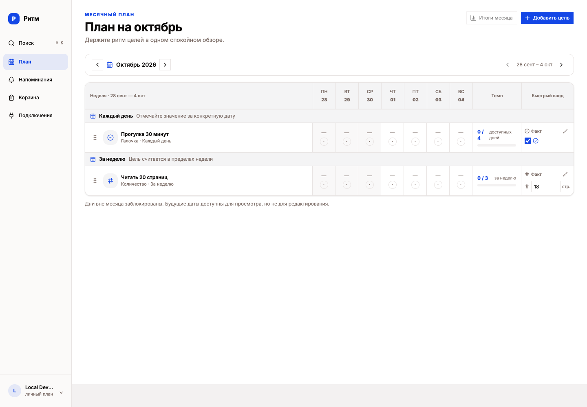
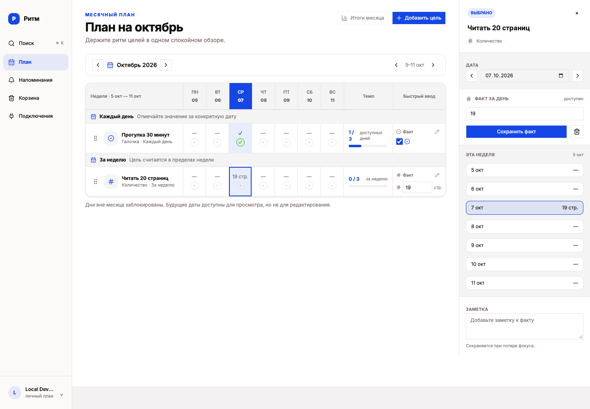
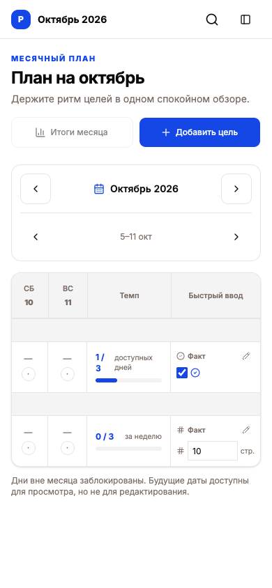
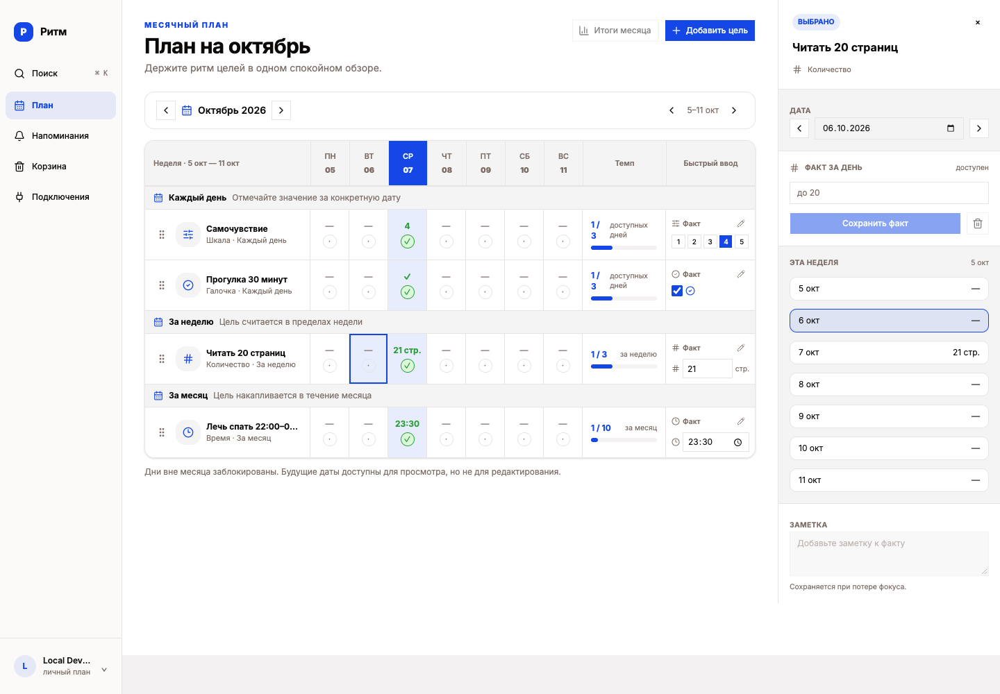
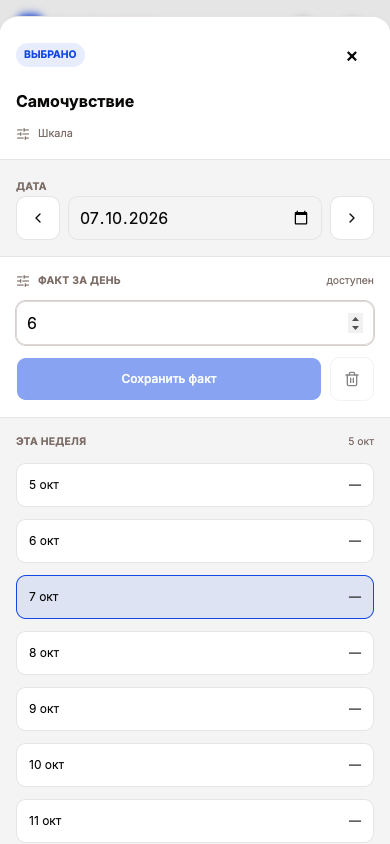

# UX/UI-аудит приложения «Ритм»

Дата: 7 октября 2026. Проверенная версия: `2209d20`, текущая рабочая копия. Аудит проведён на работающем приложении в Chromium, затем наблюдения сопоставлены с реализацией. Исходный код и дизайн приложения не изменялись.

По результатам аудита созданы [девять GitHub issues с приоритетами и критериями готовности](issues.md).

## 1. Общая оценка

**Базовый цикл «создать цель → записать результат → увидеть прогресс» работает и понятен. Основные затруднения возникают при повторном использовании: изменении цели, выборе даты записи и исправлении результата.**

На пустом плане понятно, с чего начать. Кнопка создания заметна, форма постепенно раскрывает параметры выбранного способа учёта, поиск помогает вернуться к нужной цели или заметке. В приложении есть работающие состояния ошибки с повторной попыткой. Это хорошая основа для ежедневного инструмента.

Два существенных пробела: быстрый ввод не показывает дату, в которую записывает значение, а созданную цель нельзя изменить или отправить в корзину через проверенный веб-интерфейс. Дополнительно мешают разные правила сохранения, потеря названий и дат при прокрутке таблицы, неверная подсказка количественного результата и молчаливое отключение сохранения при ошибочном значении шкалы.

Визуальная система в целом узнаваема: синий акцент, нейтральный фон, стабильная боковая навигация, единая группировка целей по частоте. Последовательность поведения слабее визуальной последовательности. Таблица значительно плотнее форм: подписи часто имеют размер 10–12 px, действия — небольшие цели нажатия. Успешные числовые результаты также имеют недостаточный контраст. Полная смена визуального стиля для решения обнаруженных проблем не требуется.

**Рабочее предположение об аудитории:** человек, который ведёт личные привычки и повторяющиеся цели, отмечает результаты с компьютера или телефона, иногда ищет старые записи и хочет получать напоминания. Аудитория и продуктовые метрики пользователем не заданы. Это экспертный проход, а не исследование с участниками; выводы о процентах ошибок, конверсии и удовлетворённости не делались.

**Среда:** `http://localhost:8788`, локальный Cloudflare Worker со Static Assets и отдельной D1, `AUTH_MODE=development`, Telegram отключён. Размеры окна — 1440×1000 и 390×844 CSS px. Узкий экран проверен изменением viewport, не на физическом телефоне. Четыре цели октября созданы через интерфейс. Для большого списка отдельно подготовлены 32 тестовые цели сентября. Для проверки восстановления одна созданная в интерфейсе цель помещена в корзину через локальный API: это подготовка состояния, а не доказательство доступности удаления для пользователя.

## 2. Проверенные сценарии

| Сценарий: исходное состояние → цель → критерий успеха | Результат | Основные наблюдения | Ограничения |
|---|---|---|---|
| **1. Начать вести цель.** Пустой месяц → задать название, способ учёта и частоту → цель видна в плане и остаётся после обновления. | Пройден. | Созданы галочка, количество, шкала и время; проверены день, неделя и месяц. Ошибки пустого названия и частоты 8 раз в неделю объясняются рядом с полем. | Первый вход проверен после автоматической локальной авторизации. Внешний вход не проходился. |
| **2. Записать и исправить результат.** Созданные цели → отметить нужный день, добавить заметку, скорректировать значение → сохранённый результат соответствует цели и дате, переживает обновление. | Пройден с существенными замечаниями. | Сохранение и исправление работают. Значение 23:30 засчитано для интервала 22:00–01:00. Быстрый ввод пишет в неочевидную дату; несохранённый черновик теряется при закрытии; недопустимая шкала не объясняет ошибку. | Сетевые ошибки искусственно воспроизведены в локальном браузере. Реального сбоя сервиса не утверждаю. |
| **3. Вернуться к нужной цели или записи.** Несколько целей и заметка → найти нужное, перейти к дню, вернуться к плану → открыт правильный контекст. | Пройден. | Поиск по названию и тексту заметки, фильтр записей с заметкой, отсутствие результатов, Enter/Escape, смена недели/месяца. На узком экране фильтры открываются отдельным экраном. | Не перебирались все сочетания фильтров и многолетняя история. |
| **4. Изменить решение о цели и восстановить удалённое.** Активная цель с результатом и заметкой → изменить параметры или убрать цель, при необходимости вернуть → доступен полный цикл управления. | Цикл ограничен интерфейсом; восстановление проверено отдельно. | Видимого пути изменения/удаления цели нет. После подготовки удалённого состояния кнопка восстановления вернула цель, результат и заметку. | Удаление через API использовано только для подготовки теста корзины. Оно не засчитано как пользовательский сценарий. |
| **5. Настроить напоминания.** Цели есть, Telegram не подключён → выбрать часовой пояс, время и дни → настройки сохраняются и остаются после обновления. | Локальная часть пройдена. | Сохранены Asia/Yekaterinburg, тихие часы 23:00–08:00, вечерний сбор 21:00, напоминание о прогулке в 09:00 по будням. Есть сообщения об успешном сохранении. | Подключение Telegram, Cron, доставка сообщения и запись ответом не проверялись: бот отключён; разрешения на реальные сообщения нет. |

### Фактические шаги прохода

Номера ниже обозначают этапы проверки, а не число кликов. Все снимки просмотрены перед включением в доказательства. [Галерея](evidence.html) содержит снимки с подписями; [машиночитаемый реестр](evidence.json) связывает файлы со состояниями.

| № | Действие и состояние | Оценка шага | Доказательства |
|---|---|---|---|
| 1 | Открыть пустой месячный план | Хорошо: понятен старт | [01](screenshots/01-empty-plan.png) |
| 2 | Найти создание цели и заполнить форму | Хорошо: заметное основное действие | [02](screenshots/02-create-default.png), [07](screenshots/07-quantity-form.png) |
| 3 | Отправить пустое название и неверную недельную частоту, исправить | Хорошо: конкретные ошибки | [03](screenshots/03-create-validation.png), [08](screenshots/08-frequency-validation.png) |
| 4 | Завершить создание и вернуться к плану | Хорошо: цель появляется, есть подтверждение | [04](screenshots/04-first-goal.png), [09](screenshots/09-two-goals.png) |
| 5 | Открыть день, записать результат и заметку | Работает; правила сохранения требуют внимания | [05](screenshots/05-day-inspector.png), [06](screenshots/06-result-saved.png) |
| 6 | Исправить количество и проверить повторное открытие | Работает при явном сохранении | [10](screenshots/10-quick-entry.png), [11](screenshots/11-quantity-inspector.png), [12](screenshots/12-result-corrected.png) |
| 7 | Ввести черновик и закрыть панель | Проблема: изменения исчезают без предупреждения | [13a](screenshots/13a-unsaved-result-before-close.png), [13](screenshots/13-unsaved-result-lost.png) |
| 8 | Найти цель и запись, открыть с клавиатуры, вернуться | Хорошо; пустой результат объясняется | [14–16](screenshots/15-search-result.png), [36](screenshots/36-search-no-results.png), [49](screenshots/49-search-note-text.png) |
| 9 | Найти изменение и удаление самой цели | Проблема: действий нет | [17](screenshots/17-goal-actions-search.png), [18](screenshots/18-trash-empty.png) |
| 10 | Настроить напоминания и перечитать настройки | Хорошо в доступной локальной части | [19](screenshots/19-reminders.png), [20](screenshots/20-reminder-saved.png) |
| 11 | Повторить план, панель, меню, формы и поиск при ширине 390 px | Формы и поиск работают; таблица теряет контекст | [21](screenshots/21-narrow-plan.png), [22](screenshots/22-narrow-plan-scrolled.png), [23](screenshots/23-narrow-inspector.png), [24](screenshots/24-narrow-navigation.png), [25](screenshots/25-narrow-reminders.png), [38](screenshots/38-narrow-search-result.png) |
| 12 | Перейти на прошлую неделю и использовать быстрый ввод | Существенная неоднозначность даты | [26](screenshots/26-previous-week-quick-entry.png), [27](screenshots/27-quick-entry-actual-date.png), [28](screenshots/28-previous-month-empty.png) |
| 13 | Создать шкалу и временную цель; проверить 6 при диапазоне 1–5, затем 4; записать 23:30 | Сохранение работает, ошибка шкалы не объясняется | [29](screenshots/29-scale-narrow-form.png), [30](screenshots/30-invalid-scale-value.png), [31](screenshots/31-time-form.png), [32](screenshots/32-time-saved.png) |
| 14 | Восстановить подготовленную удалённую цель | Работает, результат и заметка сохранены | [33](screenshots/33-trash-with-test-goal.png), [34](screenshots/34-restored-trash-feedback.png), [35](screenshots/35-restored-goal-note.png) |
| 15 | Просмотреть длинное название и 32 цели | Проблема: при прокрутке исчезают даты | [39](screenshots/39-large-plan-top.png), [40](screenshots/40-large-plan-scrolled.png) |
| 16 | Повторить запись после ошибки; открыть будущий день; проверить подсказку и удаление записи | Повторная попытка и запрет будущего редактирования работают; подсказка и удаление требуют исправления | [41](screenshots/41-simulated-save-error.png), [42](screenshots/42-save-retry-success.png), [43](screenshots/43-future-date-readonly.png), [44](screenshots/44-quantity-wrong-hint.png), [45](screenshots/45-deleted-fact-with-note.png) |
| 17 | Восстановиться после ошибки загрузки; проверить подключения и фокус поиска | Повторная загрузка и возврат фокуса работают; внешнее подключение не выполнялось | [46](screenshots/46-simulated-plan-load-error.png), [47](screenshots/47-connections-local-state.png), [48](screenshots/48-search-keyboard-focus.png) |

## 3. Приоритетные UX/UI-проблемы

### UX-01. Быстрый ввод записывает результат в дату, которой нет в видимой неделе

**Экран и шаг:** план октября, шаг 12; показана неделя 28 сентября — 4 октября, ввод количества в правой колонке.

**Наблюдение:** поле «Быстрый ввод» оставалось активным и показывало 18. В него введено 19. Открытие панели карандашом показало сохранённое значение 19 за **7 октября**; таблица переключилась на неделю 5–11 октября. У поля до действия не было даты. Поведение повторно проверено независимым драйвером браузера.

**Возможное затруднение:** пользователь может отнести поле к показанной неделе и перезаписать результат другого дня. Изменение не видно среди показанных дат, поэтому трудно сразу проверить действие.

**Предложение:** дать быстрому вводу явную дату: например, «Сегодня · 7 октября». Если он всегда относится к сегодняшнему дню, визуально отделить его от выбранной недели и не назначать прошлому месяцу неявный день. Альтернатива — единая выбранная дата для всех способов записи, явно показанная над полем. После сохранения показывать «Записано за 7 октября» и переход к этой записи.

**Приоритет: высокий.** Неоднозначность относится к ключевому действию записи данных.

**Причина после исследования реализации:** `quick-fact-input.tsx:29` вычисляет дату через `clampPlannerDate(today, today, month)` независимо от `weekDates`; `goal-row.tsx:56` использует ту же дату для карандаша. По коду в прошлом месяце она ограничивается границей месяца; отдельная запись через быстрый ввод в прошлый месяц вручную не проверялась.

### UX-02. Нет доступного управления уже созданной целью

**Экран и шаг:** месячный план, поиск и корзина, шаг 9; попытка изменить название/порог или убрать цель.

**Наблюдение:** заголовок цели не открывает её настройки. Карандаш открывает только результат за день. В строке и поиске не обнаружено меню изменения или удаления цели. В навигации есть корзина, но поместить цель в неё из проверенного интерфейса нельзя. После первого пользовательского прохода проверено, что соответствующие API существуют, а их клиенты изменения/удаления не используются интерфейсом целей. [Экран строки и панели](screenshots/17-goal-actions-search.png), [пустая корзина](screenshots/18-trash-empty.png).

**Возможное затруднение:** опечатку, неподходящий порог или частоту нельзя исправить; прекращённая цель остаётся в плане. Создание ещё одной цели увеличит список и разделит историю.

**Предложение:** сделать название ссылкой на параметры цели и добавить к строке доступное меню «Изменить цель» / «Переместить в корзину». В редактировании показывать название, описание, условие и частоту. При изменении способа учёта явно определить судьбу существующей истории. После перемещения в корзину предложить «Отменить». Восстановление связать с кнопкой «Открыть в плане».

**Приоритет: высокий.** Важный сценарий исправления решения не завершается через веб-интерфейс.

**Точки исправления:** `goal-row.tsx:66`, `plan-model.ts:44`; API-клиенты изменения и удаления в `shared/api/generated/planning/planning.ts`. Наличие API не засчитано как пользовательская доступность функции.

### UX-03. Разные правила сохранения приводят к потере черновика

**Экран и шаг:** панель результата, шаги 5–7; изменение числового значения и закрытие крестиком.

**Наблюдение:** быстрый ввод сохраняется при уходе из поля или Enter, заметка — при уходе из поля, значение в панели — отдельной кнопкой. Сохранённое значение 19 заменено в панели на 12; после закрытия без нажатия кнопки и повторного открытия снова показано 19. Предупреждения или обозначения несохранённого состояния не было. [Черновик 12](screenshots/13a-unsaved-result-before-close.png), [после повторного открытия — 19](screenshots/13-unsaved-result-lost.png).

**Возможное затруднение:** освоенный в соседнем поле способ сохранения не переносится на панель. Пользователь должен помнить три правила и может потерять исправление. Подпись «Сохраняется при потере фокуса» описывает техническое событие, а не понятный результат.

**Предложение:** использовать в панели одну явную кнопку «Сохранить результат и заметку», статус «Есть несохранённые изменения» и выбор «Сохранить / Не сохранять / Продолжить» при закрытии изменённой панели. Быстрый ввод оставить автоматическим, но обозначить его как таковой и показывать «Сохранено». Возможен единый режим автоматического сохранения, если он одинаково надёжно реализован для обоих полей.

**Приоритет: средний.** Само сохранение работает, но его непоследовательность создаёт повторный ввод и риск незамеченного отказа от изменения.

**Причина:** локальное состояние в `fact-inspector-draft.tsx:46`, явное сохранение значения на строке 105 и отдельное сохранение заметки при `onBlur` на строке 117.

### UX-04. При прокрутке таблицы исчезает контекст записи

**Экран и шаг:** план на ширине 390 px и план с 32 целями, шаги 11 и 15.

**Наблюдение:** область таблицы шириной 356 px содержит контент шириной 860 px. В начальной позиции видны названия и начало недели; при горизонтальной прокрутке к быстрому вводу названия целей полностью уходят за край. При вертикальной прокрутке большого списка на компьютере исчезают заголовки дат. Длинное название обрезается многоточием. Это прокрутка внутри таблицы; переполнение всей страницы не установлено.

Дополнительные доказательства: [начальная позиция 390 px](screenshots/21-narrow-plan.png), [длинный список после прокрутки](screenshots/40-large-plan-scrolled.png).

**Возможное затруднение:** приходится запоминать цель или день и возвращаться прокруткой для проверки. Похожие строки усиливают неоднозначность.

**Предложение:** на узком экране дать основной режим «выбранный день»: название, условие, результат и изменение в одной карточке; неделю оставить переключаемым обзором. Для таблицы закрепить заголовок дат, а при горизонтальной прокрутке — название либо компактную подпись выбранной цели. Сначала показывать текущий день. Полное название раскрывать через доступную карточку цели.

**Приоритет: средний.** Запись возможна, но требует заметного удержания контекста и лишней навигации.

**Причина:** `plan-grid.tsx:96` — горизонтальная прокрутка и минимальная ширина 860 px; `goal-row.tsx:63` — фиксированные колонки без закрепления первой.

### UX-05. Условия выполнения скрыты или объясняются неверно

**Экран и шаг:** панель количественного результата и шкалы, шаги 13 и 16.

**Наблюдение:** для цели с условием **«не меньше 20 стр.»** пустое поле результата за 6 октября показывает **«до 20»**. Условие сравнения и единица не выведены рядом с полем постоянно. Для шкалы 1–5 ввод 6 отключает кнопку сохранения без сообщения; границы были только в placeholder и исчезли после ввода. В строке цели видны тип и период, а не полное условие.

**Возможное затруднение:** подсказка может изменить понимание самой цели; отключённая кнопка не объясняет, как исправить ввод. При возвращении к цели приходится вспоминать настройки.

**Предложение:** в панели постоянно показывать «Не меньше 20 стр. · 3 раза в неделю», у поля — единицу измерения. Placeholder использовать только как пример числа. У шкалы оставить подпись «От 1 до 5» и сообщение «Введите целое число от 1 до 5» с `aria-invalid` и связанной подсказкой. Аналогично показывать временной интервал.

**Приоритет: средний.** Значения можно исправить, но интерфейс даёт неверный ориентир или не даёт его вовсе.

**Причина:** `fact-value-editor.tsx:68` всегда формирует `до targetValue`, не учитывая сравнение; строка 97 отключает кнопку по валидности без текста ошибки. `plan-model.ts:44` возвращает только тип и период.

### UX-06. Удаление результата сразу удаляет и заметку

**Экран и шаг:** панель прогулки за 7 октября, шаг 16; нажатие иконки корзины рядом с сохранением.

**Наблюдение:** у записи были отметка выполнения и заметка «Прогулка после обеда — тестовая заметка». Одно нажатие «Удалить факт» убрало обе части. Диалога, предупреждения о заметке и «Отменить» не появилось. Поле заметки стало пустым и недоступным. Для продолжения теста значение и текст введены заново. [До удаления](screenshots/35-restored-goal-note.png), [после удаления](screenshots/45-deleted-fact-with-note.png).

**Возможное затруднение:** небольшая иконка рядом с основной кнопкой может привести к потере текста, который пользователь не собирался удалять. Корзина целей не предоставляет восстановления отдельной записи.

**Предложение:** после удаления показывать «Результат и заметка за 7 октября удалены» и действие «Отменить», действительно восстанавливающее обе части. Если отмена недоступна, перед удалением записи с заметкой подтверждать обе части действия. В доступном имени кнопки указать дату и состав удаляемых данных.

**Приоритет: средний.** Сценарий исправления усложняется потерей связанного текста; основной цикл сохранения не блокируется.

**Причина:** `fact-inspector-draft.tsx:84` сразу запускает удаление; `fact-value-editor.tsx:102` выводит только кнопку с иконкой.

### UI-07. Мелкие значимые значения и подписи имеют недостаточный контраст

**Экран и состояние:** заполненный план и создание шкалы, шаги 2, 13 и 16.

**Наблюдение:** успешные «21 стр.» и «23:30» имеют размер 12 px, цвет `#2f9f3d` на `#e7edfc`, контраст около **2,91:1**. У ряда подписей формы размер 10,4–12 px; контраст серого текста на сером фоне — около **4,40:1**, у «без лимита» — **4,09:1**. Это подтверждено axe 4.12.1 и сопоставлено с видимыми элементами. [Заполненный план](screenshots/42-save-retry-success.png), [форма шкалы](screenshots/29-scale-narrow-form.png), [данные проверки](accessibility.json).

**Возможное затруднение:** результат и подсказки сложнее прочитать при слабом зрении или неблагоприятном освещении. Это относится к рабочим данным, а не только к декоративным элементам.

**Предложение:** затемнить токен успешного текста и вторичных подписей так, чтобы обычный текст имел минимум 4,5:1 на всех используемых фонах. Значения результатов и ключевые подписи таблицы увеличить хотя бы до 14 px с проверкой плотности. Сохранить галочку как дополнительный признак успеха.

**Приоритет: средний.** Затронута читаемость часто используемых данных.

Критерий взят из [WCAG 2.2, Contrast Minimum](https://www.w3.org/WAI/WCAG22/Understanding/contrast-minimum). 4,40 нельзя округлять до проходного 4,5. Неактивные элементы не использовались как доказательство этого нарушения. Автоматическая проверка не заменяет полный аудит доступности.

### A11Y-08. Доступное имя ячейки не содержит результат

**Экран и шаг:** заполненная недельная таблица, шаги 6 и 16; фокус на кнопке дня.

**Наблюдение:** видимое содержимое кнопки — «21 стр. ✓», её `aria-label` — «Читать 20 страниц, СР 07». Значение и выполнение не входят в доступное имя. Быстрые галочки называются «Отметить выполнение» / «Снять отметку выполнения» без названия цели и даты. Дополнительно axe обнаружил два вложенных `main` и отсутствие отдельного навигационного ориентира у бокового меню. Это проверка DOM и дерева доступности; реальный экранный диктор не запускался. [Видимый экран](screenshots/42-save-retry-success.png), [данные](accessibility.json).

**Возможное затруднение:** при последовательном переходе по элементам управления недостаточно сведений, чтобы определить результат, дату и цель без дополнительного исследования страницы. Вложенные главные области делают переход по ориентирам менее однозначным.

**Предложение:** формировать имя вида «Читать 20 страниц, 7 октября 2026, 21 страница, условие выполнено. Изменить результат»; для быстрого ввода тоже включать цель и явную дату. Оставить один `main`, меню оформить как `nav` с понятным именем. Проверить чтение и редактирование в VoiceOver/NVDA.

**Приоритет: средний.** Это конкретный риск доступности основного сценария, без утверждения о проведённом тесте с диктором.

**Точки исправления:** `goal-row.tsx:104`, `quick-fact-input.tsx:78`, `plan-overview-content.tsx:63`, `planner-shell.tsx:19`.

### UI-09. Недоступные «Итоги месяца» занимают место рядом с основным действием

**Экран и шаг:** заголовок плана, шаги 1 и 4.

**Наблюдение:** рядом с «Добавить цель» постоянно отображается отключённая кнопка «Итоги месяца». В реализации есть подсказка `title` «Недоступно: отчёты ещё не подключены»; непосредственно на экране объяснение не видно. [Пустой план](screenshots/01-empty-plan.png).

**Возможное затруднение:** пользователь видит обещание функции, но не понимает по экрану, нужно ли сначала заполнить план. На сенсорном экране подсказка по наведению не решает вопрос.

**Предложение:** до готовности убрать действие из основного ряда либо заменить на явно подписанное «Итоги месяца — скоро» с доступным объяснением. Сохранить приоритет «Добавить цель».

**Приоритет: низкий.** Основные проверенные действия остаются доступны.

## 4. Что исправить первым

| Порядок | Конкретное изменение | Почему сейчас | Проверяемый результат |
|---|---|---|---|
| **1** | Явная дата быстрого ввода и подтверждение даты сохранения — UX-01 | Устраняет неоднозначность при записи в основную историю | На другой неделе до ввода понятно, за какой день изменится результат; после ввода открыт или назван этот же день. |
| **2** | Параметры и меню управления существующей целью — UX-02 | Позволяет завершить исправление цели и связывает план с уже работающей корзиной | Через интерфейс можно исправить название/порог, убрать тестовую цель и восстановить её с историей. |
| **3** | Единое явное сохранение результата и заметки; защита черновика — UX-03 | Убирает необходимость помнить разные правила и повторять ввод | Изменение значения и заметки сохраняется одной кнопкой; закрытие изменённой панели не теряет черновик молча. |
| **4** | Постоянно видимые условия и конкретная ошибка ввода — UX-05 | Небольшое изменение устраняет неверную подсказку и объясняет отключённое сохранение | Для ≥20 показано «не меньше 20 стр.»; для 6 в шкале 1–5 появляется понятная ошибка, исправление на 4 сохраняется. |
| **5** | Сохранение названия и даты при прокрутке; удобная запись одного дня на узком экране — UX-04 | Делает повторную запись понятной на телефоне и в большом списке | При 390 px и при прокрутке 32 целей до нажатия видны цель и дата; длинное название можно раскрыть. |

Следом: отмена удаления результата с заметкой, контраст и доступные имена. Они зафиксированы отдельными задачами, чтобы исправление заметных сценариев не скрыло вопросы доступности. Если основной канал использования — экранный диктор, A11Y-08 следует поднять в первый набор работ.

## 5. Что уже хорошо

- **Первый экран ведёт к действию.** В пустом плане есть короткое объяснение и «Создать цель»; не требуется изучать меню.
- **Создание подстраивается под способ учёта.** Галочка, количество, шкала и время раскрывают соответствующие параметры. Необязательное описание обозначено, частота ограничена понятным диапазоном.
- **Ошибки формы создания конкретны.** Пустое название и 8 раз в неделю дают объяснение и позволяют исправиться без потери остального ввода.
- **Навигация сохраняет ориентиры.** Раздел выделен, месяц подписан, из форм есть возврат к плану; панели результата показывают дату и историю недели.
- **Поиск развит и применим на узком экране.** Есть начальная подсказка, различие целей и записей, фильтры, активные условия и сброс, количество результатов и открытие в плане. Поиск по заметке находит нужный день. Enter открывает результат, Escape закрывает поиск и после завершения анимации возвращает фокус к кнопке запуска.
- **Ошибки сохраняют путь продолжения.** При искусственном 503 быстрый ввод оставил 21 в поле, показал ошибку и позволил повторить сохранение; ячейка обновилась с 19 до 21. Ошибка загрузки плана также восстановилась кнопкой «Повторить».
- **Ограничение будущих дат объясняется.** День 8 октября открывается для просмотра, панель прямо говорит «только просмотр», изменение недоступно.
- **Восстановление цели возвращает историю.** После восстановления сохранились результат и заметка. В корзине виден понятный CTA восстановления.
- **Настройки напоминаний подтверждают сохранение.** Часовой пояс, тихие часы и дни описаны, отключённый бот не мешает подготовить расписание.
- **Успех обозначен не одним цветом.** В плане есть число/время и галочка; это решение следует сохранить при исправлении контраста.

## 6. Непроверенные вопросы и точные ограничения

| Вопрос | Причина и что уже проверено | Что потребуется дальше |
|---|---|---|
| Реальная авторизация, выход и истечение сессии | Локальный запуск использует development-авторизацию; проверен первый пустой план после входа. Конфигурация и команды запуска исследованы. Продакшен-URL не задан. | Отдельный тестовый аккаунт и разрешённая среда с рабочей авторизацией. Пройти вход, отказ, возврат и истечение сессии. |
| Telegram: подключение, отправка, ответ, доставка по Cron | Бот намеренно отключён. Проверены сообщение о статусе, настройки, сохранение и повторное чтение. Реальные сообщения не отправлялись. | Авторизованный тестовый бот/чат и явное разрешение на отправку. Проверить тихие часы, часовой пояс, доставку и запись ответом. |
| Использование внутри ChatGPT | Осмотрен экран «Подключения», его тексты и отсутствие ключа. Ключ не создавался, к внешнему клиенту приложение не подключалось. | Отдельное согласованное тестовое подключение и проход в клиенте ChatGPT. |
| Удаление/изменение цели через веб-интерфейс | Локализован продуктовый пробел UX-02. Проверены строка, заголовок, карандаш, поиск, корзина и потребители API. Восстановление проверено с локально подготовленной удалённой целью. | Реализованный пользовательский вход в эти действия; затем повторить полный цикл без API-подготовки. |
| «Итоги месяца» | Кнопка намеренно `disabled`; код содержит объяснение о неподключённых отчётах. Это не сбой инструмента. | Реализация отчётов и критерии полезного месячного итога. |
| Физический телефон, Safari/Firefox, экранная клавиатура, сенсорные жесты | Проверены только Chromium и viewport 390×844. Формы, меню, поиск и панель осмотрены; контекст таблицы проверен прокруткой. | Устройства или соответствующая матрица браузеров; проверить клавиатуру поверх формы, зоны касания и поведение высоты экрана. |
| Полный аудит доступности | Выполнены клавиатурные проходы поиска, анализ доступных имён и axe на форме и двух состояниях плана. Дикторы, увеличение 200–400%, все сочетания фокуса и перестановка целей только клавиатурой не проверены. | VoiceOver/NVDA, увеличение и отдельный полный проход без мыши. Не считать текущую проверку сертификатом WCAG. |
| Нагрузка, многолетние данные и конфликты между вкладками | Проверено 32 цели и длинное название, 4 вида учёта, обновление и повторные действия. Это тест читаемости и навигации, а не производительности. | Репрезентативная история на тестовых данных, контролируемые задержки, две сессии и правила разрешения конфликтов. |

### Диагностика препятствий

1. **Локальный запуск.** Изучены инструкции, root/package scripts и конфигурация единого Worker. Первоначальному запуску мешали права песочницы на локальный сокет и журнал Wrangler. Использованы отдельный каталог состояния и путь журнала; после разрешённого локального запуска применены семь миграций, UI и API отвечали. Это не отнесено к UX приложения.
2. **Браузерный драйвер.** При работе через первый драйвер наблюдались повторные клавиатурные события `Unidentified` и несоответствующие командам переходы по неделям. Проверены ответ сервера и состояние отдельного браузера; драйвер перезапущен. Спорные действия повторены через Playwright в том же изолированном Chromium. Нормальные одиночные переходы подтверждены. Неконтролируемые скачки не записаны как дефект приложения; доказательства UX-01 сняты повторно после устранения проблемы инструмента.
3. **Ошибка сервера.** 503 при записи и загрузке были намеренно подставлены маршрутизацией браузера. После снятия подстановки оба сценария завершились успешно. Эти снимки показывают обработку ошибки, а не наличие неисправности backend.
4. **Удалённая цель и большой список.** Недостающие состояния безопасно подготовлены только в отдельной локальной D1. Четыре основные цели до этого созданы обычным пользовательским путём. Рабочие данные не читались и не удалялись.

### Проверка репозитория и состав результата

Использованы Node `24.18.0` и pnpm `11.15.1`. `pnpm build` и корневой `pnpm check` завершились успешно, включая smoke-проверку единого Worker: SPA, static assets, API, OpenAPI, health и маршрутизация webhook. Предупреждение сборки о крупных чанках не интерпретировано как измеренная проблема скорости. Код, импорты и структура пакетов не менялись. Deployment, push, удалённые миграции и Telegram-операции не выполнялись.

Материалы: этот отчёт, [галерея доказательств](evidence.html), [реестр снимков](evidence.json), [дополнительные данные доступности](accessibility.json), каталог `screenshots/`. Ранее существовавшие материалы архитектурного обзора оставлены без изменений.
