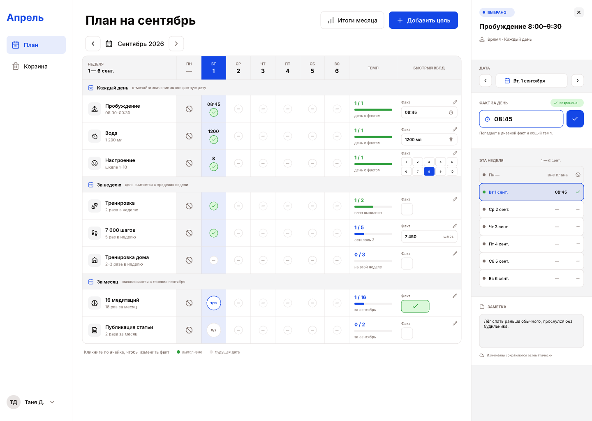

# UI design references

These PNG exports are the visual reference for AI agents and developers. Open
the images before changing the Planner plan screen or the goal-creation flow.
The editable source is [Planner.pen](./Planner.pen). Keep the `images/` directory
alongside it; it contains an image used by the document. The PNG exports let
repository-based agents inspect the current layout without local Pen access.

## September plan

The screen contains a weekly/monthly plan grid and a right-side fact inspector.
Controls in the grid represent checkbox, count, scale, and time tracking.

## Goal-creation variants

This screen documents the supported combinations of tracking type and period.
Use the API contract and `src/app/styles/index.css` as the semantic source for
fields and visual tokens.

## Global search

[Search screens and interaction rules](./search/README.md) document the proposed
global search: initial state, results with a preview, expanded filters, and mobile.
The editable screens and reusable components are in the existing `Planner.pen`,
to the right of the earlier layouts. The search folder includes native PNG exports,
mobile detail/filter screens, and empty, loading, and error states.

## Telegram notifications

`Planner.pen` contains reusable Telegram components and 12 notification scenarios
inside iPhone 17 Pro frames. They cover checkbox, count, scale and time tracking,
the evening digest, postponement, corrections, account connection, reply input
with the iOS keyboard, validation errors, and bot commands.

## Goal progress and scheduled reports

[Progress and Telegram report mockups](./progress/README.md) cover weekly and
monthly statistics, all tracking types, comparisons and streaks, the shared start
date, report settings, empty and error states, and six Telegram message variants.
The same `Planner.pen` contains 53 editable screens and state boards, a navigation
map, and reusable components under «Прогресс». Desktop, 390 px and 320 px exports
are indexed with frame IDs, reproducible sample data, interaction notes, and
coverage of the specification.
