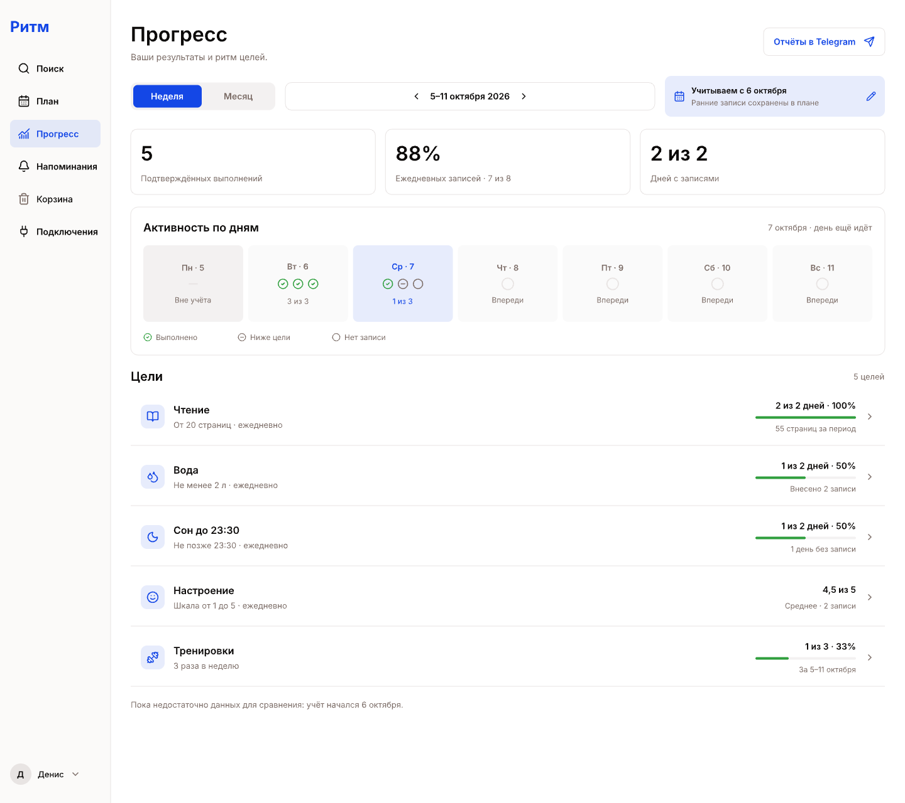
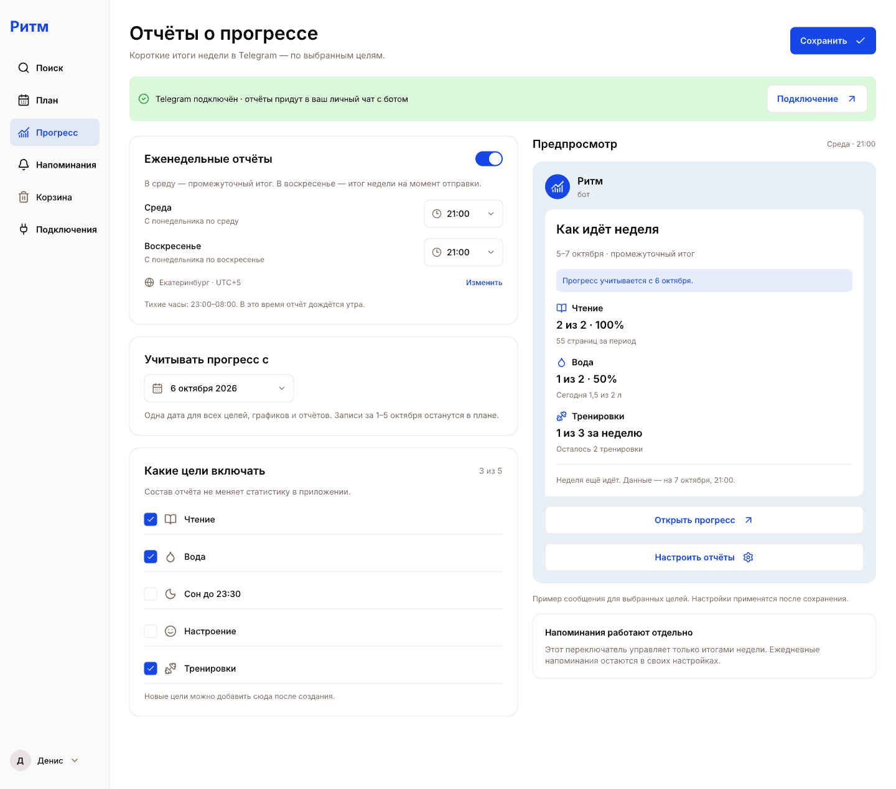

# Прогресс целей и отчёты Telegram

Редактируемые макеты находятся в [Planner.pen](../Planner.pen), в разделе
«Прогресс» справа от существующих экранов. Текст, карточки, графики, иконки и
элементы формы — отдельные слои Pen. PNG ниже экспортированы из этих слоёв.

Это макеты будущей функциональности по
[ТЗ](../../../../docs/progress-and-telegram-reports.md), а не работающие экраны
приложения. Существующие экраны плана, создания целей, поиска и Telegram сохранены.

## Экраны

| Экран | Узел в Pen | PNG |
| --- | --- | --- |
| Недельный обзор, компьютер | `IJar7` | [1440 × 1280](./week-desktop.png) |
| Недельный обзор, телефон | `iRvJs` | [390 × 1540](./week-mobile.png) |
| Статистика чтения, компьютер | `VJMzK` | [1440 × 1100](./goal-desktop.png) |
| Статистика чтения, телефон | `OtGaJ` | [390 × 1210](./goal-mobile.png) |
| Настройки отчётов, компьютер | `ycerX` | [1440 × 1270](./telegram-settings-desktop.png) |
| Настройки отчётов, телефон | `qArpO` | [390 × 1390](./telegram-settings-mobile.png) |
| Сообщение в Telegram | `SZnty` | [390 × 900](./telegram-message.png) |

Длинные мобильные фреймы показывают всё содержимое прокручиваемой страницы.
Компоненты обзора собраны на фрейме `kynaE`: навигация, показатель, строка цели,
мобильная карточка, переключатель периода и общая дата начала. В настройках
переиспользуются переключатель рассылки и строка выбора цели.

## Обзор и детализация

Главные показатели разделяют подтверждённые выполнения, заполненность ежедневных
целей и дни с записями. Общего процента для разных типов целей нет. У настроения
показано среднее по шкале, без полосы успешности. Недельные тренировки имеют
собственный план; свободные дни не становятся пропусками.

В карточке активности различаются выполненное условие, запись ниже цели,
отсутствие записи, исключённый день и будущий день. Сегодня отмечено как
незавершённое. На графике чтения есть значения фактов и линия цели 20 страниц;
для будущих дней факты не нарисованы.

Переходы при реализации:

- Нажатие на цель открывает её статистику; «Все цели» возвращает обзор.
- «Неделя / Месяц» и стрелки меняют период. Эти фреймы показывают недельный режим;
  правила месячного режима описаны в ТЗ.
- Дата рядом с периодом открывает редактирование общего начала учёта. Это то же
  значение, что и в настройках отчётов, с сохранением и возможностью очистить дату.
- «Изменить» у факта открывает существующий редактор записи.
- «Отчёты в Telegram» открывают настройки рассылки.

## Настройки Telegram

Среда и воскресенье имеют отдельные поля времени. Значения 21:00 показаны как
предложенные настройки. Часовой пояс аккаунта и тихие часы видны рядом.
Один переключатель управляет отчётами; ежедневные напоминания остаются отдельной
настройкой. Флажки выбирают цели для обоих отчётов и не фильтруют экран прогресса.

На компьютере предпросмотр расположен справа от формы, на телефоне он открывается
кнопкой «Предпросмотр отчёта». Сохранение применяет весь черновик настроек.
Валидация, ошибки сохранения, отключённый Telegram, пустая выборка целей и будущая
дата учёта описаны в ТЗ; отдельных визуальных состояний в этом наборе нет.

В макете сообщения видны период, общая дата начала, результаты только выбранных
целей и момент формирования сводки. Кнопки ведут к прогрессу и настройкам.
Макет не отправляет сообщения и не включает расписание.

## Данные примера

Все экраны используют фиксированный пример на **7 октября 2026 года, 21:00**
в часовом поясе `Asia/Yekaterinburg`. Это не текущие пользовательские данные.
Неделя — 5–11 октября, начало учёта — 6 октября включительно. За 8–11 октября
результатов ещё нет; 1–5 октября сохранены в плане и исключены из статистики.

| Цель | 6 октября | 7 октября | Показатель |
| --- | --- | --- | --- |
| Чтение, ≥ 20 страниц в день | 25 | 30 | 2 из 2; 55 страниц; среднее 27,5 |
| Вода, ≥ 2 л в день | 2,1 | 1,5 | 1 из 2; обе записи внесены |
| Сон не позже 23:30 | 23:15 | Нет записи | 1 из 2 |
| Настроение, шкала 1–5 | 4 | 5 | Среднее 4,5; 2 записи |
| Тренировки, 3 раза в неделю | Выполнено | Нет записи | 1 из 3 за неделю |

Отсюда: 5 подтверждённых выполнений; 7 из 8 ежедневных записей, округлённо 88%;
2 из 2 дней с записями. Недельный план тренировок после отсечения понедельника
остаётся 3: `ceil(3 × 6 / 7) = 3`. Для сравнения с прошлой неделей недостаточно
учитываемой истории. В Telegram выбраны чтение, вода и тренировки.

## Работа с исходником

Редактировать через Pen MCP; не разбирать зашифрованный `.pen` как JSON.
Использовать существующие семантические цвета и Inter. После изменений сохранить
документ в Pen и обновить PNG соответствующих фреймов в масштабе 1×.

Проверка макета: просмотр семи PNG, проверка геометрии всех семи фреймов через
Pen MCP, сверка чисел между обзором, детализацией и сообщением. Обрезанных слоёв
в проверенных фреймах нет.
