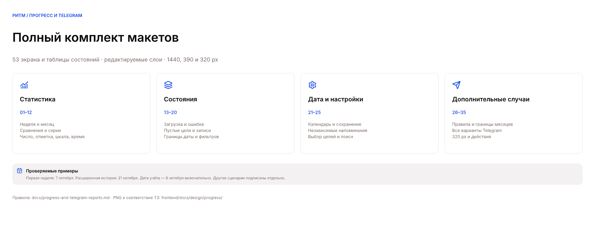
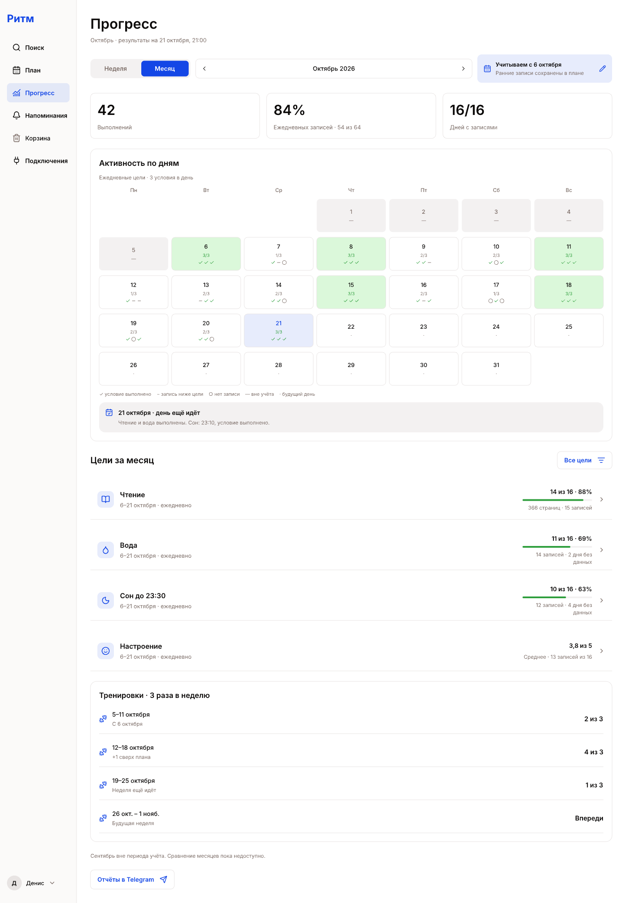

# Прогресс целей и отчёты Telegram

Полный комплект макетов первой версии по
[ТЗ](../../../../docs/progress-and-telegram-reports.md): **53 экрана и таблицы
состояний**, карта макетов и переиспользуемые компоненты. Редактируемый исходник —
[Planner.pen](../Planner.pen), разделы «Прогресс / …» справа от прежних экранов.
Текст, графики, карточки, иконки и формы собраны отдельными слоями Pen.

Это дизайн будущей функциональности. Макеты не запускают рассылку и не являются
работающим интерфейсом или интерактивным прототипом. Существующие макеты плана,
создания целей, поиска и подключения Telegram сохранены.

Все 54 PNG экспортированы из исходника в масштабе 1×. Полный список узлов,
названий и размеров находится в [frames.json](./frames.json). Фреймы с несколькими
состояниями — таблицы вариантов компонентов, а не отдельные страницы приложения.
Длинные мобильные фреймы показывают всё содержимое прокручиваемой страницы.

## Основные экраны

| Экран | Компьютер, 1440 px | Телефон, 390 px |
| --- | --- | --- |
| Неделя | [PNG](./week-desktop.png) · `IJar7` | [PNG](./week-mobile.png) · `iRvJs` |
| Месяц | [PNG](./month-desktop.png) · `NMjXR` | [PNG](./month-mobile.png) · `EWC2M` |
| Чтение: первый период | [PNG](./goal-desktop.png) · `VJMzK` | [PNG](./goal-mobile.png) · `OtGaJ` |
| Чтение: сравнение и серии | [PNG](./comparison-desktop.png) · `UZAmv` | [PNG](./comparison-mobile.png) · `hpuK2` |
| Отметка: тренировки | [PNG](./check-detail-desktop.png) · `Iedlb` | [PNG](./check-detail-mobile.png) · `T56J5` |
| Шкала: настроение | [PNG](./scale-detail-desktop.png) · `KckiD` | [PNG](./scale-detail-mobile.png) · `bU1iS` |
| Время: сон | [PNG](./time-detail-desktop.png) · `ytHPN` | [PNG](./time-detail-mobile.png) · `Z7I26` |
| Общая дата начала учёта | [PNG](./start-date-desktop.png) · `CaBm2` | [PNG](./start-date-mobile.png) · `a7LzqK` |
| Напоминания и отчёты | [PNG](./reminders-desktop.png) · `ImbhQ` | [PNG](./reminders-mobile.png) · `mz5oD` |
| Настройки отчётов | [PNG](./telegram-settings-desktop.png) · `ycerX` | [PNG](./telegram-settings-mobile.png) · `qArpO` |

Обзор разделяет подтверждённые выполнения, заполненность ежедневных целей и дни
с записями. Общего процента для целей разных типов нет. В календаре различаются
выполнение, внесённый результат ниже цели, отсутствие записи, исключённый и будущий
день. Сегодня помечено как незавершённое. Графики сна и настроения имеют свои оси
и текстовые значения. Отсутствующий факт не превращается в ноль.

## Загрузка, ошибки и пустые состояния

| Состояние | Компьютер | Телефон |
| --- | --- | --- |
| Загрузка статистики | [PNG](./state-loading-desktop.png) · `FqChd` | [PNG](./state-loading-mobile.png) · `q4keBJ` |
| Ошибка с повтором | [PNG](./state-error-desktop.png) · `eqqPl` | [PNG](./state-error-mobile.png) · `OuNTP` |
| Нет целей | [PNG](./state-goals-desktop.png) · `nBHQQ` | [PNG](./state-goals-mobile.png) · `cVdVO` |
| Нет записей | [PNG](./state-entries-desktop.png) · `bR2Yt` | [PNG](./state-entries-mobile.png) · `rlByB` |
| Период раньше начала учёта | [PNG](./state-before-desktop.png) · `Hhvij` | [PNG](./state-before-mobile.png) · `Y0iQP` |
| Учёт начнётся в будущем | [PNG](./state-future-desktop.png) · `M97CZ` | [PNG](./state-future-mobile.png) · `c1hSoY` |
| Цель удалена или недоступна | [PNG](./state-missing-desktop.png) · `Pw3fc` | [PNG](./state-missing-mobile.png) · `P4462y` |
| Фильтр не дал результатов | [PNG](./state-filter-desktop.png) · `cBImK` | [PNG](./state-filter-mobile.png) · `zb04G` |

## Формы, действия и особые случаи

| Набор | PNG и узел | Что показано |
| --- | --- | --- |
| Состояния общей даты | [PNG](./start-date-states.png) · `iXnee` | Вся история, будущая дата, сохранение, успех, ошибка, несуществующая дата |
| Состояния отчётов | [PNG](./telegram-settings-states.png) · `DQbgA` | 16 состояний: выключено, нет Telegram, пустой выбор, приостановка, загрузка и сохранение с ошибками, тихие часы, неверное время, предпросмотр, ошибки доставки и отключение чата |
| Выбор целей | [PNG](./goal-selection-states.png) · `cRrRV` | Длинный список, поиск, отсутствие результатов, массовый выбор |
| Фильтры и действия | [PNG](./interaction-states.png) · `SfULy` | Фильтр просмотра, возврат к текущему периоду, фокус и подсказка графика, переход к факту, предупреждение о пересчёте при смене правила |
| Мобильный фильтр | [PNG](./goal-filter-mobile.png) · `LNOeU` | Нижняя панель выбора целей для просмотра |
| Варианты правил | [PNG](./goal-rule-variants.png) · `uhwCG` | Время через полночь и без условия, ноль, ≤ и =, уменьшенный месячный план, недельные результаты по отдельности |
| Границы и сравнения | [PNG](./comparison-boundary-states.png) · `kSgo4` | Сопоставимые месяцы, изменённые правила, отсутствующий соседний месяц, разные состояния серии |

## Telegram

| Сообщение | PNG и узел |
| --- | --- |
| Среда: промежуточный итог | [PNG](./telegram-message.png) · `SZnty` |
| Воскресенье: итог недели | [PNG](./telegram-sunday.png) · `f1f4JE` |
| За период нет записей | [PNG](./telegram-no-entries.png) · `E3Jt09` |
| Длинная сводка: 17 из 20 целей | [PNG](./telegram-truncated.png) · `H3B6b` |
| Воскресный отчёт после тихих часов | [PNG](./telegram-delayed.png) · `votHE` |
| Месячная цель, шкала и время | [PNG](./telegram-goal-types.png) · `J1Mes1` |

В сообщениях видны исходный период, дата начала учёта и момент формирования.
Среда охватывает понедельник–среду, воскресенье — понедельник–воскресенье.
При переносе на утро понедельника исходная неделя сохраняется. Для месячной цели
отдельно показаны результат недели и накопление за месяц.

Сокращённая сводка содержит 17 полных блоков и ссылку на ещё 3 цели. Её текст
занимает 3455 символов при внутреннем бюджете 3500; следующий блок целиком
не помещается. Названия с `*` и `_` отображаются буквально. Точный текст и
исходные 20 целей сохранены в `largeReport` файла [sample-data.json](./sample-data.json).
При пустом выборе целей или будущем начале учёта сообщение не формируется —
эти случаи показаны в настройках и на экране прогресса.

## Узкий экран, 320 px

| Экран | PNG и узел |
| --- | --- |
| Неделя | [PNG](./week-320.png) · `DpCbC` |
| Месяц с календарём | [PNG](./month-320.png) · `PENYj` |
| Настройки отчётов | [PNG](./settings-320.png) · `KkbUO` |
| Выбор даты | [PNG](./start-date-320.png) · `zSjRn` |

## Переходы и правила взаимодействия

- «Неделя / Месяц» и стрелки меняют период; возврат к текущему периоду показан
  отдельно. При реализации выбранный период сохраняется в URL.
- Нажатие на цель открывает её статистику. «Все цели» возвращает обзор.
  Временный фильтр просмотра не меняет состав отчётов.
- Дата рядом с периодом и поле в настройках меняют одно значение аккаунта.
  Выбор в календаре остаётся черновиком до «Сохранить». Очистка означает всю
  историю. Ошибка сохраняет черновик и прежнюю действующую дату. Ранние факты
  остаются в плане. Закрытие без сохранения отменяет изменения.
- «Изменить» у записи открывает существующий редактор факта в плане.
  Подсказка графика открывается также с клавиатуры; сведения доступны в списке
  значений. Фокус показан на таблице действий.
- Отчёты и напоминания о заполнении имеют независимые переключатели.
  Отключение самого Telegram-чата останавливает оба вида сообщений.
- Среда и воскресенье имеют отдельные поля времени. Часовой пояс и тихие часы
  используют настройки аккаунта. Форма показывает две ближайшие реальные даты
  отправки. Их значения обновляются после успешного сохранения расписания.
- Поиск целей не сбрасывает выбор. При активном поиске массовое действие
  применяется к показанным результатам; выбранные цели вне поиска сохраняются.
  Нулевой результат поиска отличается от пустого общего выбора.
- «Сохранить» применяет весь черновик настроек отчётов. Во время сохранения
  повторное действие недоступно; ошибка оставляет прежние настройки действующими.
  Выключенную рассылку можно сохранить без подключения и выбранных целей.
- Предпросмотр использует черновик и те же правила сокращения, что сообщение.
  Он показывается на сайте и ничего не отправляет. Подключение чата и изменение
  часового пояса ведут в существующие настройки аккаунта.

## Данные примера

Это вымышленные данные, сохранённые в [sample-data.json](./sample-data.json).
Часовой пояс — `Asia/Yekaterinburg`, начало учёта — **6 октября 2026 включительно**.
Снимки намеренно относятся к разным датам, указанным на каждом экране.

| Снимок | Проверяемые результаты |
| --- | --- |
| 7 октября, 21:00 | 5 выполнений; 7 из 8 ежедневных записей = 88%; 2 дня с записями. Чтение: 55 страниц, 2/2. Вода: 1/2. Сон: 1/2. Настроение: 4,5. Тренировки: 1/3 |
| 21 октября, 21:00 | 42 выполнения; 54 из 64 ежедневных записей = 84%; 16 дней с записями. Чтение: 366 страниц, 14/16. Вода: 11/16. Сон: 10/16. Настроение: 3,8 по 13 оценкам |
| Сравнение 19–21 с 12–14 октября | Чтение: 3/3 против 2/3, +33 п. п.; 79 против 61 страницы. Настроение: по 3,5, без оценки «лучше/хуже». Сон: 2/3 против 1/3 |
| Воскресенье, 11 октября | Чтение: 152 страницы, 6/6. Вода: 4/6, одна отсутствующая запись. Тренировки: 2/3 |

В октябре недельные тренировки показаны отдельно: 2/3, 4/3, 1/3 и будущая неделя.
После отсечения 5 октября недельный план остаётся `ceil(3 × 6 / 7) = 3`.
Для отдельного примера месячного плана: `ceil(20 × 26 / 31) = 17`.
Сравнение с сентябрём недоступно из-за даты начала; допустимое сравнение месяцев
показано отдельным примером на таблице границ. Примеры иных правил и серий
не входят в сводные 42 выполнения.

## Покрытие ТЗ

| Раздел ТЗ | Макеты |
| --- | --- |
| §3: общая дата и границы учёта | Диалог даты, 6 состояний сохранения, «Период до старта», «Будущий старт» |
| §4.1–4.2: отсутствие данных и типы целей | Детализации чтения, тренировок, настроения, сна; таблица вариантов правил |
| §4.3: план недели и месяца | Месячный обзор, уменьшенный план, недельные строки и превышение плана |
| §4.4: сводные показатели, сравнения, серии | Неделя, месяц, сравнение, таблица границ и серий |
| §4.5: месячные версии и удаление | Разные правила на границе месяцев, отсутствующий будущий месяц, недоступная цель |
| §5: экран прогресса и адаптивность | Основные экраны, 8 пар состояний, действия, 390 и 320 px |
| §6: форма отчётов | Настройки, отдельные напоминания, 16 состояний формы, поиск и массовый выбор |
| §7.1: состав сводки | 6 вариантов Telegram, полный текст длинного сообщения |
| §7.2: расписание и доставка | Ближайшие отправки, перенос через тихие часы, временная ошибка, неизвестный результат, отключённый чат |

Серверные расчёты, миграции, защита ссылок, сохранение, доступность с клавиатуры
и работа Cron проверяются при реализации. Макеты задают их видимое поведение;
визуальная проверка не подтверждает работу этих механизмов.

## Работа с исходником

Редактировать через Pen MCP; не разбирать зашифрованный `.pen` как JSON.
Использовать семантические цвета проекта, Inter и компоненты фрейма `kynaE`:
навигацию, показатель, строку цели, мобильную карточку, период, дату, переключатель
и выбор цели. Карта комплекта — `RHvwO`.

После изменений сохранить документ в Pen, обновить затронутые PNG в масштабе 1×,
реестр `frames.json` и примеры данных. При подготовке комплекта проверены геометрия
всех фреймов, размеры экспортов и расчёты примеров; просмотрены основные экраны,
формы, графики, сообщения и узкие варианты. Допуск проверки геометрии — 0,5 px
для погрешности дробных размеров.
