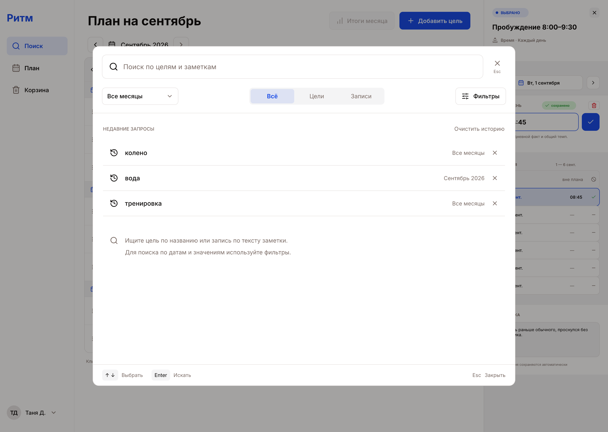
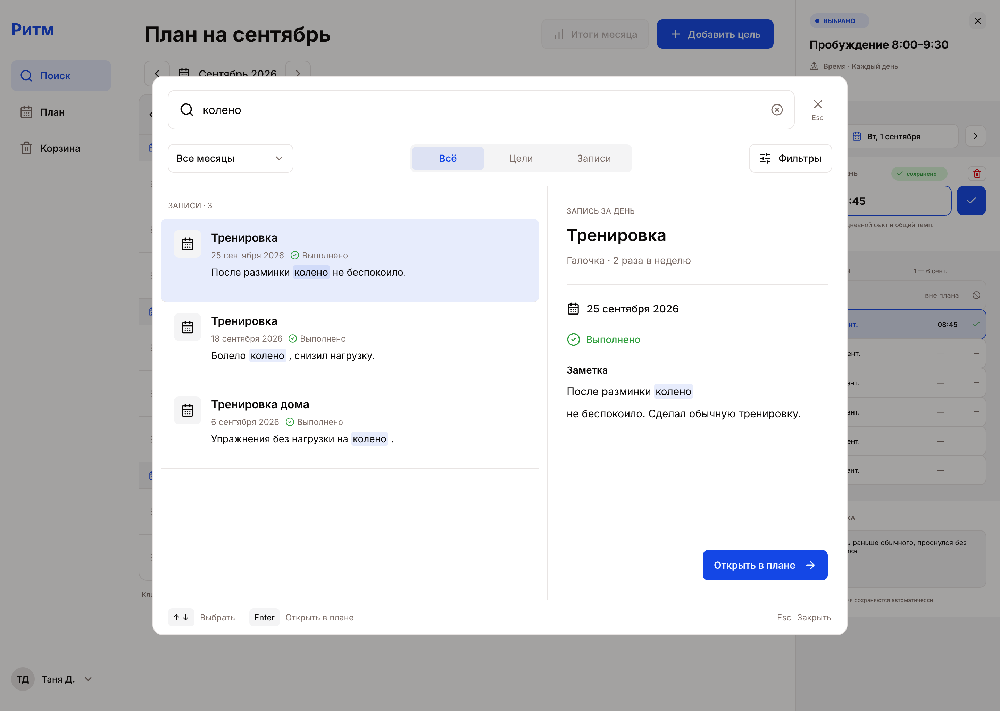
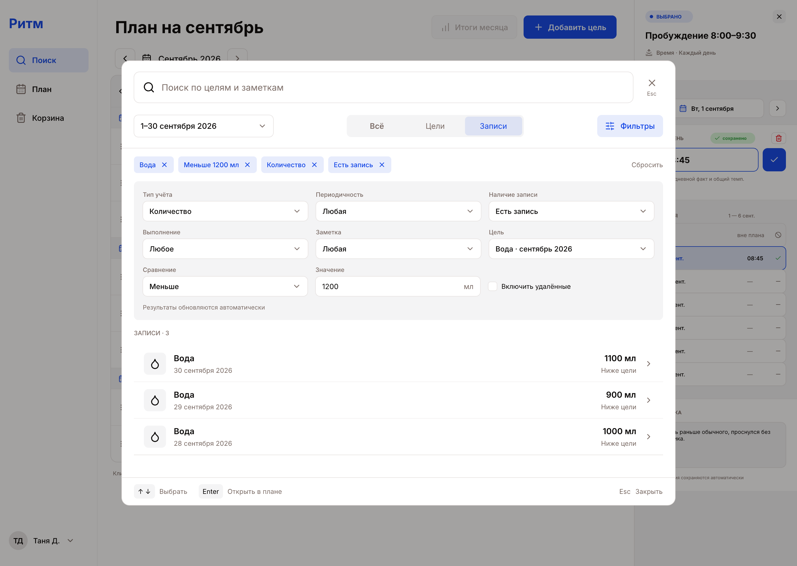
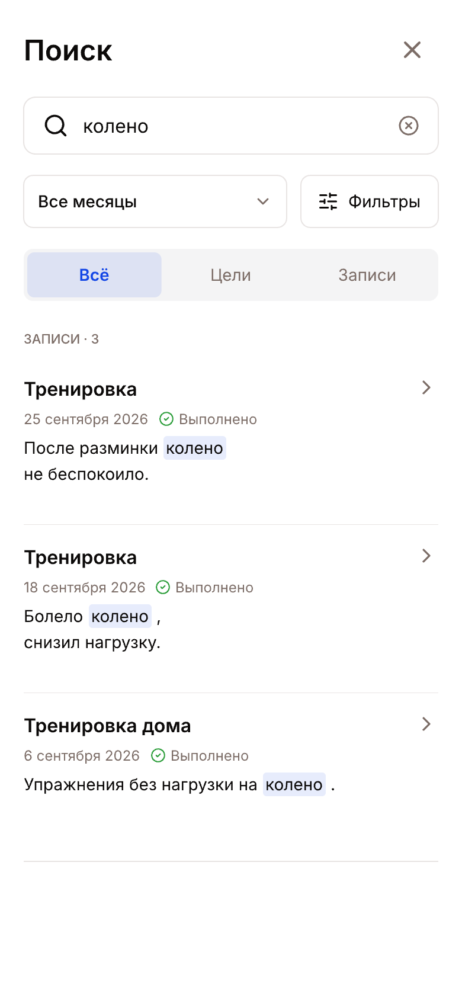
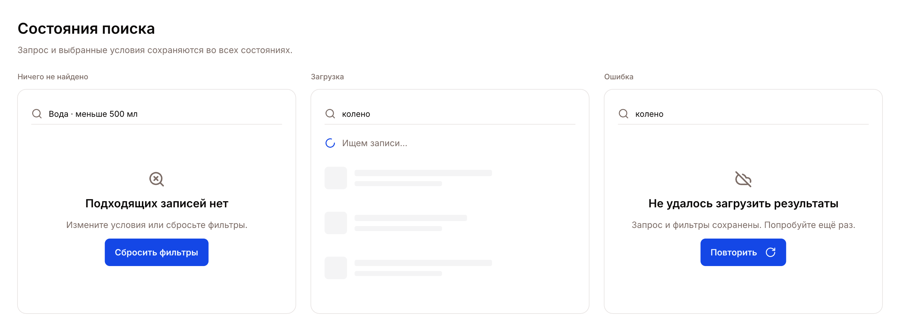

# Поиск в «Ритме»

Редактируемый макет одного глобального поиска по целям и записям за день.
Добавлен 7 октября 2026 года в существующий
[`Planner.pen`](../Planner.pen) на основе
[существующего экрана плана](../plan-september.png) и семантических токенов
[`src/app/styles/index.css`](../../../src/app/styles/index.css).

Семь фреймов поиска находятся справа от прежних экранов, начиная с x=4820.
Над ними расположены общие компоненты и варианты результатов. Текст, иконки,
контролы и раскладка редактируются в Pen; повторяющиеся элементы связаны
с компонентами. PNG в `native/` экспортированы из этого же документа.

## Экраны

| Экран | Узел Pen | Экспорт | Сценарий |
| --- | --- | --- | --- |
| Начальное состояние | `bWqMr` | [initial.png](./native/initial.png) | Пустой запрос, история, выбор области поиска |
| Результаты и предпросмотр | `MhwFd` | [results-preview.png](./native/results-preview.png) | Найти тренировку по слову в заметке и открыть день в плане |
| Раскрытые фильтры | `VAsDT` | [filters.png](./native/filters.png) | Найти записи цели «Вода» со значением меньше 1200 мл |
| Мобильный поиск | `IPYSB` | [mobile.png](./native/mobile.png) | Полноэкранная выдача |
| Мобильные подробности | `F8SA6` | [mobile-preview.png](./native/mobile-preview.png) | Просмотр записи, возврат к выдаче и переход в план |
| Мобильные фильтры | `iq3wR` | [mobile-filters.png](./native/mobile-filters.png) | Выбор условий и возврат к результатам |
| Состояния поиска | `Kw0jY` | [states.png](./native/states.png) | Нет совпадений, загрузка и ошибка |

Компоненты: `Ynnud` — [основные элементы](./native/components.png),
`HLNPe` — [цель, день без записи и удалённая цель](./native/result-variants.png).

## Начальное состояние

- Вход через «Поиск» в боковом меню или Cmd+K / Ctrl+K.
- На компьютере поиск открывается поверх текущего плана.
- Фокус сразу в строке «Поиск по целям и заметкам».
- По умолчанию выбраны «Все месяцы» и вкладка «Всё».
- При пустом запросе без фильтров показаны недавние запросы и подсказка.
- Можно повторить запрос, удалить одну запись истории или очистить всю историю.
- В историю попадают завершённые запросы, а не каждый введённый символ.
- Кнопка очистки строки нужна только при непустом запросе; закрытие поиска
  остаётся отдельным действием.
- Пустая строка с активными фильтрами показывает подходящие результаты.
- При закрытии восстанавливаются фокус, открытый план и положение прокрутки.

## Результаты и предпросмотр

- Цели ищутся по названию и описанию, записи за день — по тексту заметки.
- Заметка отображается вместе со своей записью, а не отдельным дубликатом.
- Область поиска: все месяцы, открытый месяц или произвольный диапазон дат.
- «Открытый месяц» означает месяц плана под поиском, а не обязательно текущий
  календарный месяц.
- Вкладки «Всё», «Цели» и «Записи» ограничивают тип результатов.
- Текстовый поиск не зависит от регистра и различий «е/ё», поддерживает части
  слов. Вероятное исправление опечатки предлагается явно.
- Точное совпадение названия выше остальных совпадений в названиях, описаниях
  и заметках. При равной релевантности более свежие результаты выше.
- У цели видны месяц и способ учёта. У записи — цель, дата, значение с единицей
  измерения, состояние и фрагмент заметки.
- Выбор строки показывает подробности справа. «Открыть в плане» переходит
  в нужный месяц, выделяет цель или ячейку и открывает панель записи.
- Стрелки выбирают результат; Enter открывает выбранный результат в плане.
  Эти команды не перехватывают работу открытых списков и календаря.
- Esc сначала закрывает открытый вспомогательный контрол, затем сам поиск.
- Фокус удерживается внутри окна. Все элементы доступны с клавиатуры.
- Возвращение к поиску сохраняет запрос, фильтры и положение в выдаче.

Демонстрационные данные исторические: 25, 18 и 6 сентября 2026 года.
Время отсчёта — 7 октября 2026 года. Даты плана под окном сохранены
из исходного макета.

## Раскрытые фильтры

Раскрытие фильтров показывает форму над выдачей на всю ширину окна.
Предпросмотр при этом скрыт. Закрытие фильтров или выбор результата
возвращает выдачу с предпросмотром, сохраняя применённые условия.

| Условие | Поведение |
| --- | --- |
| Даты | Выбираются через область поиска в верхней строке |
| Способ учёта | Галочка, количество, шкала, время |
| Период цели | Каждый день, за неделю, за месяц |
| Запись за день | Любое состояние, есть запись, нет записи |
| Выполнение | Любое состояние, условие цели выполнено или не выполнено |
| Заметка | Любое состояние, есть или нет |
| Цель | Конкретная цель с указанием её месяца |
| Значение | Сравнение или диапазон, соответствующие типу выбранной цели |
| Корзина | Удалённые цели и их записи включаются отдельным переключателем |

- Условия применяются автоматически. Активные ограничения отображаются
  над выдачей и снимаются по одному; есть общий сброс.
- Фильтры записей переключают выдачу на записи за день.
- Значение сравнивается только после выбора конкретной цели. Единица
  измерения берётся из цели, несопоставимые величины не объединяются.
- Для количества и шкалы доступны больше, меньше, равно и диапазон.
  Для времени — раньше, позже и интервал с явным отображением границ.
- Для галочки числовое сравнение скрыто.
- «Нет записи» рассматривает только прошедшие дни и сегодня. Это отдельное
  состояние, а не автоматически невыполненная цель.
- В режиме «Нет записи» текст ищется по названию и описанию цели: заметки
  у такого дня ещё нет. Сохранённые ноль и «не выполнено» считаются записями.
- При «Нет записи» недоступны сравнение значения, выполнение записи и
  требование наличия заметки. Несовместимые условия явно снимаются.
- Выполнение относится к условию конкретного дня, а не к общему выполнению
  недельной или месячной частоты.
- Удалённые результаты помечены и ведут в корзину; переход сам по себе
  не восстанавливает цель.

В макете выбраны сентябрь 2026 года, цель «Вода» и значение меньше 1200 мл.
Показаны записи 1100, 900 и 1000 мл, упорядоченные по убыванию даты.

## Мобильный поиск

- Полноэкранный интерфейс с теми же запросом, областью, вкладками и фильтрами.
- Результаты идут одним списком; строка целиком доступна для нажатия.
- Нажатие открывает полноэкранные подробности выбранной записи.
- Из подробностей можно открыть запись в плане или вернуться к выдаче
  с сохранением запроса, фильтров и прокрутки.
- Фильтры открываются отдельной прокручиваемой панелью. Закрытие возвращает
  к отфильтрованной выдаче.
- Управление рассчитано на касание, интерактивные области не меньше 44 px.
- Макет соответствует логическому экрану 390 × 844; экспорт имеет повышенную
  плотность пикселей. Десктопные экраны соответствуют композиции 1440 × 1024.

## Остальные состояния и правила реализации

- Загрузка имеет видимый индикатор; запоздалый ответ не подменяет результаты
  более нового запроса.
- При отсутствии совпадений сохраняются запрос и видимые ограничения,
  доступны сброс фильтров и исправление запроса.
- При ошибке остаются введённые условия и доступно повторение запроса.
- Пустая история не создаёт фиктивных запросов: остаётся подсказка.
- Поиск работает только с данными текущего пользователя.
- Границы «сегодня» и прошедших дней используют часовой пояс планировщика.
- Редактируемые фреймы в `Planner.pen` задают композицию и иерархию.
  PNG являются их превью. Цвета реализации берутся из существующих
  семантических токенов; подсветка совпадения использует `primary-soft`
  с контрастным текстом. Размеры шрифтов и областей нажатия задаются в
  логических пикселях, а не копируются из растрового экспорта.

Первоначальные растровые эскизы Image Gen сохранены отдельно от актуальных
экспортов: `initial.png`, `results-preview.png`, `filters.png`, `mobile.png`
в корне этой папки. Их [запросы](./prompts.md) оставлены как история работы;
источник актуального макета — `Planner.pen` и экспорты в `native/`.

## Реализация

Интерфейс находится в `frontend/src/features/search`, подключён к меню плана
и загружается при первом открытии. API `/api/search` и `/api/search/goals`
принадлежит модулю planning. В ChatGPT общий интерфейс использует инструменты
`search_planner` и `get_search_goals`.

История хранится локально отдельно для каждого аккаунта, не более восьми
завершённых запросов; её можно очистить целиком или по одному пункту. Запросы
отправляются после паузы 250 мс, устаревшие ответы не заменяют новую выдачу.
Большой результат загружается страницами по 50 элементов. Ошибка следующей
страницы сохраняет уже загруженные результаты и позволяет повторить запрос.
